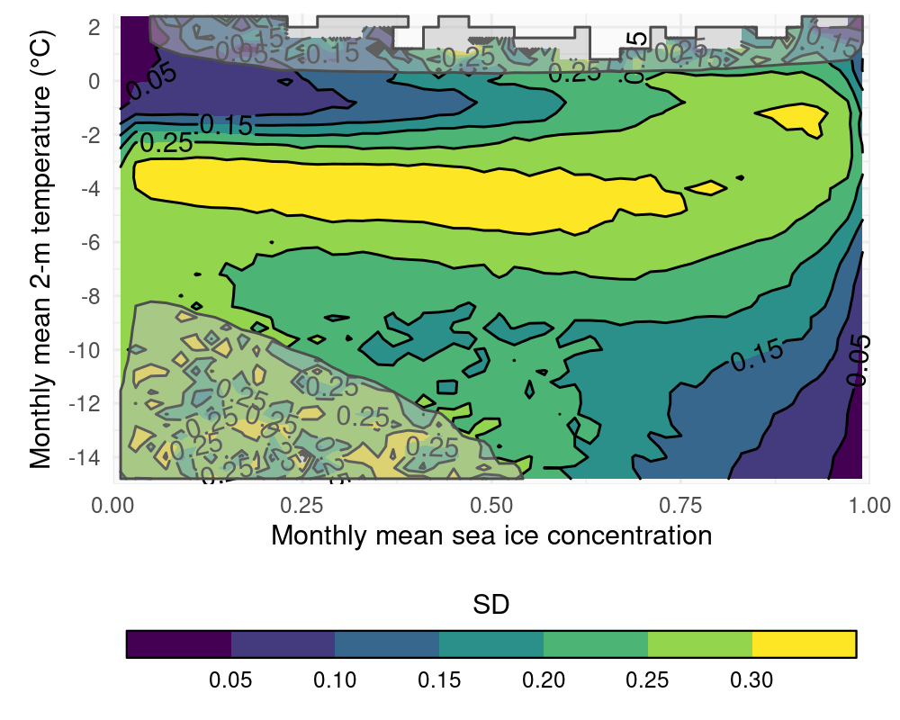
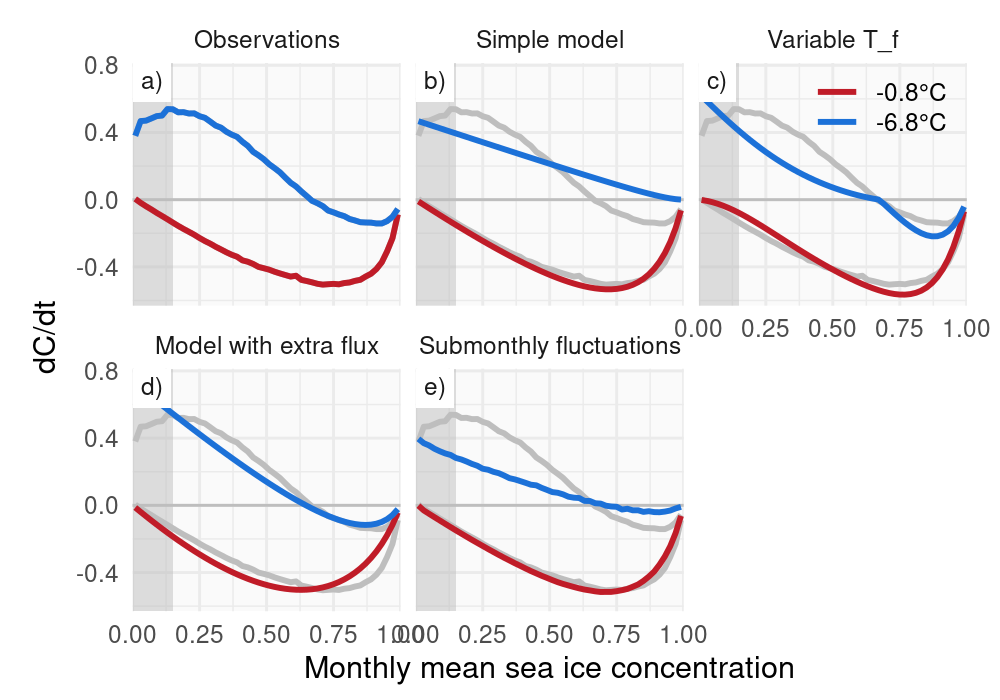
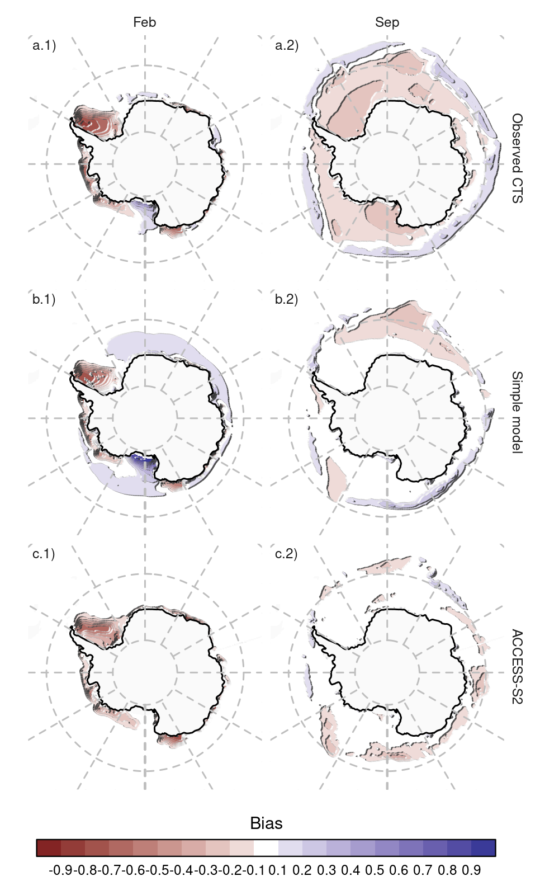
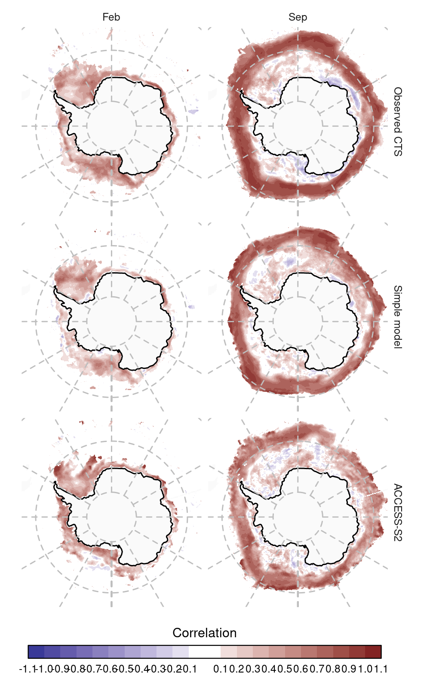
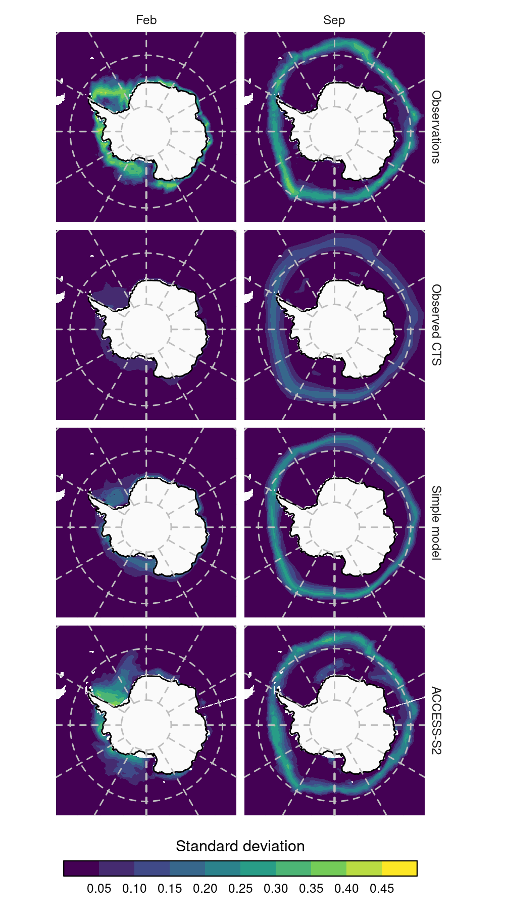
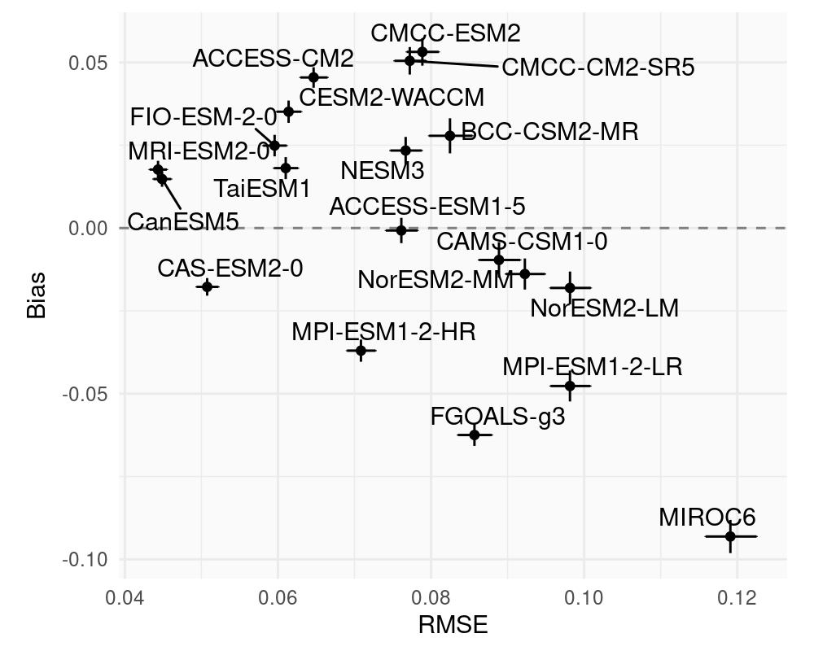
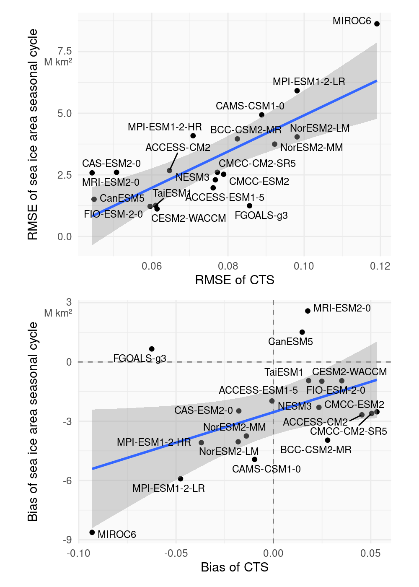
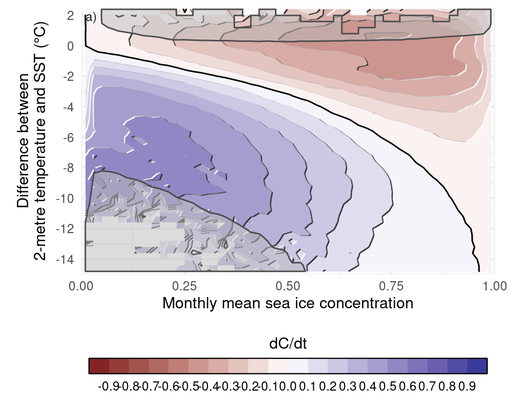
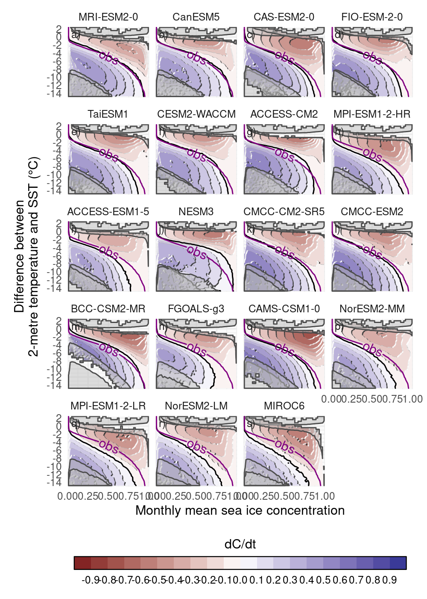
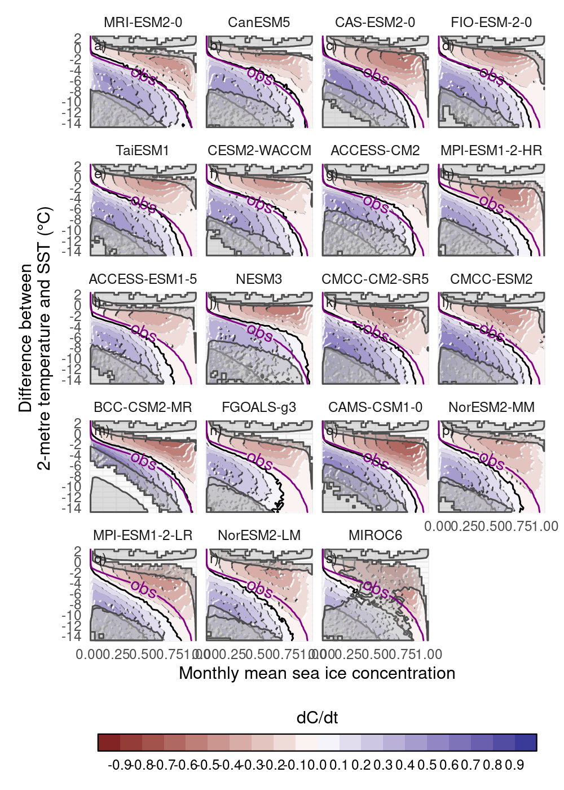

## Abstract

\todo{TODO}

## plain-language-summary

\todo{TODO}

## Introduction

The abrupt drop in Antarctic sea ice extent around 2015--2016 after decades of steady increase [@turner2017] challenges our understanding of sea ice variability. 
This sudden change has raised the question of whether sea ice has experienced a critical transition [@purich2023; @hobbs2024], suggesting that Antarctica has entered an uncharted territory. 
Critical transitions are not only abrupt, but potentially irreversible in human timescales, therefore determining whether one has happened could inform future expectations. 

Under certain assumptions, we would expect an increase in standard deviation and autocorrelation of a time series as it approaches a critical transition [@lenton2011].
So these early warnings of critical transitions can, in principle, help us detect them. 
@hobbs2024 suggest that the standard deviation of Antarctic sea ice area has been increasing since records began in the 1980s.
They, as well as @raphael2025, also measured an increase in autocorrelation but, inconsistent with the detection of a critical transition, only after the 2016 rapid loss.
This statistical evidence is far from definitive in part due to the short length of the observational record. 

Theoretical models of sea ice evolution could help us contextualise the scant observations available. 
However, state-of-the-art climate models struggle to simulate the observed Antarctic sea ice mean state and variability [@roach2020] due to inadequate representation of key sea ice processes, external atmospheric or oceanic forcing, or both. 
There is some evidence that incorrect representation of atmospheric trends plays a role [@purich2016].
By nudging model winds toward observations above 850 hPa, @espinosa2024 was able to simulate the record-low sea ice extent in 2023, although not the preceding expanding trends or the dramatic change in 2015. 
On the other hand, @roach2023 was able to reproduce sea ice expansion via wind forcing, but not the post-2015 decline.
Earlier, @blanchard-wrigglesworth2021 managed to improve Antarctic sea ice trends in the CESM model, including the expansion in 1990--2015 and the post-2015 decline.
However, mean state biases were not significantly affected and the model simulated a strong decrease in the 1980--1990 incompatible with observations. 
They conclude that model biases might not come from biased winds, but from problems in the model's ice thermodynamics. 

Simpler conceptual models could also assist in our understanding, and considerable work has been done in developing theoretical models of floe thickness evolution based on the heat exchange through the ice[@thorndike1992; @lepparanta1993; @jones2025].
However, the main diagnostic of Antarctic sea ice is total or regional sea ice area, which these models don't attempt to simulate. 
The focus on sea ice area is due in part to observational constraints, as it is much easier to detect the presence and absence of sea ice than it is to estimate its thickness, but also due to its physical relevance: the effect of sea ice on albedo and heat transfer depends only weakly on thickness beyond a few centimetres [@makshtas1991]. 
A simplified model of sea ice concentration (and thus area) amenable to bifurcation analysis would help to bridge the gap between our observations and the theory of critical transitions. 

Sea ice grows and melts as the ocean loses or gains heat to the atmosphere, so near-surface air temperature is a crucial variable to consider. 
But, since sea ice insulates the ocean from the atmosphere, heat transfer between the ocean and the atmosphere depends also on the sea ice cover. 
An area with high sea ice cover will exchange little heat with the atmosphere even in the presence of a strong temperature difference, whereas an area with lots of ice-free surface will experience big heat fluxes even with mild anomalies. 
Furthermore, sea ice concentration is bounded, which means that even low or high temperature anomalies can only have an effect where there's open water to freeze or sea ice to melt respectively.
This means that the state of the sea ice itself is an important factor that modulates the net effect of any air temperature forcing. 
This state dependence implies that the relationship between air temperature and sea ice concentration cannot be linear. 

Dynamically, sea ice is in constant motion, so advection and divergence of sea ice floes will affect sea ice concentration locally without thermodynamic melt or freeze [@holland2012].
Ice processes such as sea ice floes crashing over each other and deforming will also change sea ice concentrations within a cell; reducing area but increasing thickness.
These are important locally but do not affect the total sea ice area except through indirect feedbacks. 
Thermodynamically, horizontal and vertical heat fluxes within the ocean will affect sea ice evolution. 
These processes do affect total area and are deemed to be important, especially in the recent sea ice retreat [@purich2023]. 
In this work, they will not be studied in order to isolate the atmospheric contribution specifically. 

Here I define a Concentration Tendency Surface as the mean change of sea ice concentration within a grid cell as a joint function of 2-metre air temperature and sea ice concentration. 
I derive a simple analytical expression for this Surface from first principles and then estimate it from observations. 
Identifying regions of discrepancy provides intuition of the effect of the missing processes in this simple model. 
I explore the validity of the Concentration Tendency Surface by integrating it forward using observed 2-metre temperature forcing. 
Finally, I evaluate the Concentration Tendency Surface of CMIP6 models to investigate if errors in this thermodynamic relationship are indicative of errors in the simulated sea ice. 

::: {.cell layout-align="center"}

:::

::: {.cell layout-align="center"}

:::

::: {.cell layout-align="center"}

:::

## Data and Methods

I use Antarctic sea ice concentration from NOAA/NSIDC's Climate Data Record V4 [CDR; @meier2014]. 
This dataset takes the maximum value of the NASA Team [@cavalieri1984] and NASA Bootstrap [@comiso2023] sea ice concentration products to reduce their low concentration bias [@meier2014; @meier2021].
Both source algorithms use data from the Scanning Multichannel Microwave Radiometer (SMMR) on the Nimbus-7 satellite and from the Special Sensor Microwave/Imager (SSM/I) sensors on the Defense Meteorological Satellite Program's (DMSP) -F8, -F11, and -F13 satellites.
The data have a spatial resolution of 25 by 25 km on a stereographic projection and are available daily from November 1978 onwards.
Monthly values are obtained by averaging the daily record, and the analysis is restricted to the period 1981--2023 to avoid the early period that used interpolated data every other day. 
I compute monthly sea ice tendency as the difference between sea ice concentration at one month and the next. 

I use monthly mean 2-metre air temperature and Sea Surface temperature (SST) from ERA5 [@hersbach2020] for the same period. 
Both variables are bilinearly interpolated to the CDR grid prior to analysis. 
In addition to the monthly mean, I also compute the monthly standard deviation of 2-metre air temperature from daily mean values. 

::: {.cell layout-align="center"}

:::

To estimate the empirical Concentration Tendency Surface (CTS), I group all grid cells and all months according to their 2-metre air temperature and sea ice concentration and compute the average sea ice tendency. 
Temperature is binned at 0.4°C intervals and sea ice concentration at 0.02% intervals.
For numerical integration, regions of the temperature-sea ice concentration space with fewer than 50 observations are imputed using the nearest values with more than 50 observations after applying a 2D locally-weighted regression (LOESS). 
Theoretical CTS are estimated by fitting their free parameters to observations by nonlinear squares [@bates1988] using the minpack.lm R package [@R-minpack.lm]. 

The CTS-based prognostic models are integrated forward in time using a fourth-order Runge--Kutta scheme forced by monthly mean 2-metre temperature from ERA5. 
Integrations are initialised from observed January 1983 sea ice concentrations and run to December 2023.

As comparison, I use ensemble mean 1 month lead time sea ice concentration hindcasts from the ACCESS-S2 coupled seasonal prediction system [@wedd2022] of the Australian Bureau of Meteorology.

::: {.cell layout-align="center"}

:::

Finally, I compute CTS of historical CMIP6 simulations [@eyring2016] (1850--2014) and the SSP5-8.5 scenario [@oneill2016]. 
Models with monthly sea ice concentration and near-surface temperature available for both experiments are used. 
All models and variables are bilinearly interpolated to a 1° grid and restricted to the Southern Ocean south of 50°S.
Only the first ensemble member (r1i1p1f1) is used.
The 17 models analysed are: ACCESS-CM2, ACCESS-ESM1-5, BCC-CSM2-MR, CAMS-CSM1-0, CanESM5, CAS-ESM2-0, CESM2-WACCM, CMCC-CM2-SR5, CMCC-ESM2, FGOALS-g3, FIO-ESM-2-0, MIROC6, MPI-ESM1-2-HR, MPI-ESM1-2-LR, MRI-ESM2-0, NESM3, NorESM2-LM, NorESM2-MM, and TaiESM1.

## Computational procedures 

I performed all analyses in this paper using the R programming language [@rcoreteam2020], using data.table [@barrett2006] and metR [@campitelli2018c] packages.
Significant processing was performed using the CDO command line operators [@schulzweida2023] via the rcdo R package [@campitelli2025b].
Sea ice models were written in C++ for speed and integrated in R using the Rcpp package [@eddelbuettel2008].
All graphics are made using ggplot2 [@wickham2009].
The paper was rendered using knitr and Quarto [@xie2015; @allaire2022].

## Results

### Simple model of sea ice growth 

I start with a simplified model of sea ice growth.
In this model, each cell has an area of water and an area covered with ice. 
Assuming that sea ice is a perfect insulator, the ocean surface exchanges heat with the atmosphere only in the ice-free surface. 
This heat flux is parameterised with a bulk formula as a function of air-sea temperature difference and constant exchange coefficient. 
Sea surface temperature is assumed to be constant and equal to the freezing point. 
This latter assumption is somewhat justified by the fact that a mixture of water and ice in thermodynamic equilibrium will stay at the freezing point, and any heat gain or loss will either melt or freeze more ice.

The full formula for the heat exchange at each gridcell is then

$$
F = \alpha (T_a - T_f) (1 - C)
$$ {#eq-flux}

where $T_f$ and $T_a$ are the freezing-point temperature of the ocean and the temperature of the atmosphere, respectively; $C$ is the proportion of the grid cell covered with ice; and $\alpha$ is a proportionality constant. 

To relate heat flux to sea ice concentration change, we can assume that $F$ is proportional to the proportion of sea ice melted or ice-free ocean frozen $F_{p}$. 

$$
F_{p} = \frac{F} {(1 + \left| F \right |)}
$$

This transformation ensures that $F_p$ is bounded between $-1$ and $1$ and parameterises a saturation point beyond which extremely strong fluxes will be partially counteracted by other processes, such as horizontal and vertical transport of heat within the top layer of the ocean. 

If $F_p$ is negative, the heat lost to the ocean is balanced by freezing. 
However, because only ice-free areas can freeze, I assume that the change in sea ice concentration is also proportional to the ice-free area. 

$$
\frac{dC}{dt} = -\beta_f F_{p} (1 - C)
$$

where $\beta_f$ is a freezing proportionality constant. 

Conversely, if $F_p$ is positive, the ocean gains heat which is used to melt ice. 
In this case it is only ice-covered areas which can melt, making the change in sea ice concentration proportional to sea ice concentration itself.

$$
\frac{dC}{dt} = -\beta_m F_{p} C
$$

where $\beta_m$ is a melting proportionality constant that in principle could be different from $\beta_f$. 

The full model, therefore, is

$$
\frac{dC}{dt} =
\begin{cases}
\frac{-\beta_f \alpha (T_a - T_f) (1 - C)^2 }{ 1 + \alpha (T_a - T_f) (1 - C)}    &  T_a \le T_f, \\
\frac{-\beta_m \alpha (T_a - T_f) (1 - C) C }{ 1 + \alpha (T_a - T_f) (1 - C)}  &  T_a 	> T_f
\end{cases}
$$ {#eq-model}

::: {.cell layout-align="center"}

:::

This simple model implies a functional form of sea ice concentration tendency as a function of air temperature and sea ice concentration. 
For conciseness, I will refer to this relationship as the Concentration Tendency Surface (CTS). 

::: {.cell layout-align="center"}
::: {.cell-output-display}
{#fig-theory fig-align='center'}
:::
:::

To illustrate the basic properties of this simple model, @fig-theory shows the change in monthly sea ice concentration as a function of sea ice concentration for temperatures in the melting and freezing regimes. 
Parameters are all set arbitrarily to 1. 
For a given temperature below freezing (blue line), sea ice growth is maximum at low sea ice concentrations since that maximises both the heat loss and ice-free ocean that is available for freezing whereas at high sea ice concentrations heat fluxes are suppressed and there is little open water to freeze, leading to slow growth. 
For a given temperature above freezing (red line), sea ice melt is slow both at low concentrations because there is little ice left to melt and at high concentrations because the ice insulates the ocean from the atmosphere. 
Maximum melt is at around 75% sea ice concentrations, when there is enough ice to melt and enough ice-free ocean for the ocean to exchange heat. 

## Observations

::: {.cell layout-align="center"}

:::

::: {.cell layout-align="center"}

:::

::: {.cell layout-align="center"}

:::

::: {.cell layout-align="center"}

:::

::: {.cell layout-align="center"}

:::

::: {.cell layout-align="center"}

:::

::: {.cell layout-align="center"}

:::

::: {.cell layout-align="center"}

:::

::: {.cell layout-align="center"}

:::

::: {.cell layout-align="center"}

:::

::: {.cell layout-align="center"}

:::

::: {.cell layout-align="center"}

:::

::: {.cell layout-align="center"}
::: {.cell-output-display}
{#fig-grid-sd fig-align='center'}
:::
:::

Before comparing the theoretical predictions with observations, it is appropirate to consider whether $dC/dt$ can be computed from sea ice concentration and 2-metre temperature at all. 
In order to do that, I compute the error in estimating $dC/dt$ as the average observed tendency as a function of these variables. 
This error, computed as the standard deviation excluding conditions where air temperature is greater than 0°C and no ice is present, is 0.160. 
For comparison, the full standard deviation of sea ice change is 0.232.
The Concentration Tendency Surface therefore explains 52% of the variance in sea ice concentration change, indicating that this can be a useful model of sea ice growth. 

@fig-grid-sd shows the standard deviation of $dC/dt$ as a function of temperature and sea ice concentration and illustrates that this mean error is in no way homogeneous. 
Both for low sea ice concentrations at higher temperatures, and for high sea ice concentration at low temperature the error is lower than 0.15.
The error increases to between 0.2 and 0.35 at temperatures between -5°C and -3°C and sea ice concentration below 0.75. 
This suggests that ice dynamics and ocean processes are particularly important at these intermediate temperatures. 

::: {.cell layout-align="center"}
::: {.cell-output-display}
{#fig-aice-lines fig-align='center'}
:::
:::

The basic properties of the simple CTS are compared with observations in @fig-aice-lines. 
Observations are computed by averaging grid cells with temperatures of -7°C and -1°C $\pm$ 0.25°C and sea ice concentration values binned in boxes 2% wide. 
The overall observed curve fits notably well with the simple theory in the melt regime. 
Melt is zero at zero concentrations by mathematical necessity, but it is also low at high concentrations, showing the stabilisation effect of sea ice insulation. 
At 100% sea ice concentrations, melt values are not exactly zero due to the binning -- which means that these values are actually the average of values between 95% and 100%.

In the growth regime, observations don't follow the simple model as well.
Although, they show low growth at high concentrations and high growth at low concentrations, they deviate from the simple model in two significant ways. 
First, at sea ice concentrations lower than 25%, growth starts to flatten out.
This could be due to missing processes, but it is also important to note that satellite observations are increasingly uncertain below ~15% and that there is no data between 0% and 10% concentrations. 
Second, at high concentrations sea ice actually melts even when exposed to low temperatures. 

::: {.cell layout-align="center"}
::: {.cell-output-display}
{#fig-daice-monthly fig-align='center'}
:::
:::

To understand this deficiency better, @fig-daice-monthly shows the complete CTS for observations and the simple model.
The black line marks the "zero line" that divides sea ice growth from melt, which is an estimate of the effective $T_f$ in @eq-flux. 
Contrary to the model's assumption, this zero line is not constant and instead depends heavily on sea ice concentration. 
At low concentration, air temperature just below -2°C is enough to cause sea ice growth on average, but as sea ice concentration increases, the air needs to be increasingly colder for ice not to melt. 
At about 50% sea ice concentration, air temperature needs to be lower than -5°C for ice to grow. 
This property cannot be captured by the model in @eq-model, which assumes that sea ice will grow whenever air temperature is below the freezing point of ocean water, which is assumed constant. 

The freezing point of water depends on salinity and sea ice growth and melt directly affect surface salinity by brine rejection and releasing fresh water. 
However, no normal sea surface salinity value could explain a freezing temperature of -5°C or below. 
Another possible issue is the assumption that ocean temperatures are constant. 
However, reproducing the same plot but using the difference between 2-metre air temperature and SST results in almost the same relationship (@fig-daice-monthly-sst).

The simple model could be altered to try to account for this discrepancy to gain insights into what is causing it. 
A direct refinement of the model is to postulate an ad-hoc dependency of $T_f$ on sea ice concentration. 
The black line in @fig-daice-monthly panel a is well modelled by a fourth-degree polynomial in @eq-tf-model fitted by linear regression. 

::: {.cell layout-align="center"}
$$
T_f = - 1.13 - 6.65C - 7.61C^2 + 24.36C^3 - 25.16C^4
$$ {#eq-tf-model}
:::

Replacing the constant $T_f$ in @eq-model with the expression in @eq-tf-model and fitting the parameters using observed data results in the CTS shown in @fig-daice-monthly panel c. 
This model reproduces the dependency of $T_f$ on sea ice concentration by definition. 
However, it slightly overestimates the melt occurring at low temperatures at high sea ice concentrations and features a discontinuity in the derivative of $dI/dt$ with respect to sea ice concentration, creating a "kink" seen in @fig-aice-lines c. 
Moreover, as this is a wholly ad-hoc modification, it is not useful for understanding the physical processes that create this dependence. 
It would be preferable to have a model in which the dependence of $T_f$ on sea ice concentration arises as an emergent property from physically motivated rules. 

A physics-based refinement of the model is to presuppose a positive heat flux representing warming of the water from below by mixing with relatively warmer subsurface water. 
Under this formulation, ice would grow only if the freezing at the surface from the atmosphere was larger than the melting from the ocean, which would require more extreme air temperature when ice insulation is higher at higher concentrations, thus creating an effective dependency on $T_f$ on sea ice concentration. 
Both wind forcing and waves can induce mixing, and both are damped by the presence of sea ice; therefore, this flux should also be proportional to the ice-free area.
In this full model, the change in sea ice concentration is decomposed into changes due to air fluxes and ocean fluxes. 

$$
\frac{dC}{dt} = \left.\frac{dC}{dt}\right|_a  + \left.\frac{dC}{dt}\right|_o 
$$

where $\left.\frac{dC}{dt}\right|_a$ is the air-temperature-induced change computed as before and $\left.\frac{dC}{dt}\right|_o$ is the bottom-ocean contribution. 

$$
\left.\frac{dC}{dt}\right|_o = \beta_m F_o C 
$$

where $F_o = \gamma(1 - C)$. 
The new parameter $\gamma$ modulates the strength of the flux. 

The results for this model with parameters fitted to observations are shown in @fig-aice-lines d and @fig-daice-monthly d.
This model produces a $T_f$ dependency comparable with observations, although the exact shape is clearly not correct; it is too flat at low sea ice concentrations and too steep at high sea ice concentrations. 

Finally, the dependence of $T_f$ on sea ice concentrations might be explained by sub-monthly temperature variations. 
For @fig-aice-lines e and @fig-daice-monthly e, I ran 5000 simulations of @eq-model in which I added a random normal perturbation to 2-metre temperature with a mean of zero and a standard deviation taken from observations of the monthly standard deviation of air temperature as a function of monthly mean temperature and monthly mean sea ice concentration (@fig-t2m_sd).
Random sub-monthly temperature fluctuations approximate $T_f$ well, but they underestimate sea ice growth at low sea ice concentrations. 
Note that the standard deviation includes daily fluctuations as well as the daily trend in temperature from the seasonal cycle. 
It is not clear why intramonthly 2-m temperature variability increases so much at low temperatures. 
Note that there is little dependence of variability on sea ice concentration, suggesting that buffering from the ocean and insulation by sea ice can only play a minor role. 

An alternative model imposing a damping forcing that relaxes sea ice concentrations towards a temperature-dependent value was tried. 
This formulation would attempt to take into account that gridpoints with either particularly high or low sea ice concentration values compared with their surroundings will tend to either export ice away or gain ice from their neighbours. 
However, the estimated damping strength from observations was minimal and could not explain the observed shape of the ice-temperature surface and was not consistent with the observed minimal melt at 100% sea ice concentrations. 

## Using the Concentration Tendency Surface to predict sea ice

::: {.cell layout-align="center"}

:::

::: {.cell layout-align="center"}

:::

Since the Concentration Tendency Surface defines a prognostic equation of sea ice concentration, I can integrate it in time using temperature fields as forcing. 
This can help in understanding what aspects of sea ice variability can be explained by the Concentration Tendency Surface. 
By integrating both the Concentration Tendency Surface from @eq-model and the observed one (@fig-daice-monthly panels b and a, respectively), I can further analyse the impact of modelling the dependency of $T_f$ on sea ice concentration. 
The observed Concentration Tendency Surface is not defined for unobserved values of sea ice concentration and temperatures, and it is highly uncertain in regions of that space with sparse observations.
To address both issues, I smooth the surface with a 2D LOESS fit, using only parts of the grid with more than 100 observations, and extrapolate the extreme values in regions with no data. 
I use ERA5 2-m temperature as forcing and integrate the models using January 1983 observations as initial conditions and run it until December 2023. 
For comparison, I use sea ice concentration forecasts with a 1 month lead time by ACCESS-S2 [@wedd2022], the Bureau of Meteorology Subseasonal to Seasonal prediction model. 

::: {.cell layout-align="center"}

:::

::: {.cell layout-align="center"}

:::

::: {.cell layout-align="center"}

:::

::: {.cell layout-align="center"}

:::

::: {.cell layout-align="center"}

:::

::: {.cell layout-align="center"}
::: {.cell-output-display}
{#fig-seasonal-cycle fig-align='center'}
:::
:::

The Concentration Tendency Surfaces seem to simulate sea ice quite well compared with a coupled model.
@fig-seasonal-cycle shows the seasonal cycle of sea ice area for simulations based on the simple model, the model based on observations, and the 1-month forecast from ACCESS-S2. 
Both CTS-based models experience a seasonal cycle of similar amplitude to observations, although in the simple model the phase is shifted by about one month. 

::: {.cell layout-align="center"}

:::

::: {.cell layout-align="center"}
::: {.cell-output-display}
{#fig-bias fig-align='center'}
:::
:::

However, this aggregated quantity hides spatial variation. 
@fig-bias shows that sea ice concentration bias is locally high in the models.
All three models show a strong low-concentration bias in the Weddell Sea in February, while the models based on Concentration Tendency Surfaces also exhibit a high-concentration bias in the Ross Sea. 
It is likely that the lack of dynamical processes in these models is what is causing this bias. 
If that is the case, then the fact that the coupled model shares the same feature suggests a problem in the dynamics of the model. 

::: {.cell layout-align="center"}
::: {.cell-output-display}
{#fig-area-anomalies fig-align='center'}
:::
:::

Despite large local biases, the CTS-based models simulate sea ice area anomalies remarkably well (@fig-area-anomalies).
Both the observed CTS and the CTS fitted on @eq-model reproduce the overall observed variabilty, including the long term increase followed by the sudden decrease in 2016 and the next decade of low sea ice.
While this suggests that these trends could be explained by atmospheric forcing alone, it is important to note that the observed temperature fields used for forcing will inevitably carry an imprint of the observed sea ice anomalies.
The overall error of the CTS-based models is significantly lower than the ACCESS-S2 error. 
Note that the ACCESS-S2 system does not assimilate sea ice concentration observations but does assimilate temperature data [@campitelli2026], making it a realtively fair comparison. 

::: {.cell layout-align="center"}

:::

::: {.cell layout-align="center"}
::: {.cell-output-display}
{#fig-spatial-cor fig-align='center'}
:::
:::

@fig-spatial-cor shows the correlation of sea ice anomalies for February and September. 
In summer, all simulations have comparably low correlation values; however, in spring, the CTS-based models show higher correlation than the coupled model at the ice edge, although correlations are near zero in the core of the ice pack. 
This likely is related to the low variance of sea ice concentrations in that region, where it's almost 100% every September. 
This can be seen in @fig-sd, that compares interannual standard deviation. 

::: {.cell layout-align="center"}
::: {.cell-output-display}
{#fig-sd fig-align='center'}
:::
:::

While the CTS-base models do well in terms of correlation and Pan-Antarctic sea ice area, one important limitation is that the variability of the simulated sea ice concentrations is much lower than either observations or the coupled model simulation (@fig-sd). 
Lower variability is not unexpected since the Concentration Tendency Surface doesn't include many sources of variability such as advection, divergence, thickness redistribution, and ocean processes. 
This lack of variabilty does not translate to lower variabilty in sea ice area, however, indicating that regional anomalies largely compensate each other when aggregated. 

## Evaluation of the Concentration Tendency Surface in CMIP6 models

The Concentration Tendency Surface shown in @fig-daice-monthly panel a is an emergent property of thermodynamic processes and interactions between sea ice and the atmosphere. 
To the extent that climate models represent these correctly, they should simulate a CTS simplar to the observed one. 
THerefore, the CTS can be used as a model evaluation tool. 

::: {.cell layout-align="center"}

:::

::: {.cell layout-align="center"}

:::

::: {.cell layout-align="center"}
::: {.cell-output-display}
{#fig-cmip-historical fig-align='center'}
:::
:::

@fig-cmip-historical shows the CTS of selected CMIP6 models. 
The overall relationship is similar in all models, but with significant deviations. 
Focusing only on the zero line, most models have a slight melt bias in the sense that they lose sea ice at lower temperatures than in observations. 
A particularly dramatic example is MIROC6 ([Fig. @fig-cmip-historical] panel s), which loses ice on average at temperatures as cold as -6°C at 50% sea ice concentration. 
The only models with a freeze bias (e.g. ice growing at higher temperatures than in observations) are ACCESS-CM2 and NESM3 ([Fig. @fig-cmip-historical]g and i). 
In other models, such as MRI-ESM2.0, CanESM5 and CAS-ESM2.0 the zero line follows observations remarkably well. 

::: {.cell layout-align="center"}
::: {.cell-output-display}
{#fig-rmse-bias fig-align='center'}
:::
:::

This evaluation of bias is incomplete since it is only based on the zero line and ignores the magnitude of melt or freezing at different temperatures and sea ice concentrations. 
@fig-rmse-bias shows the bias and RMSE in change in sea ice concentration of each model compared with observations. 
Of the 19 evaluated models, 8 have an overall negative bias and 10 have a positive bias compared with observations. 
For ACCES-ESM1.5, even thoguh its zero line is slightly "warm" ([Fig. @fig-cmip-historical]) and stands in the middle of the pack in terms of RMSE, negative and positive errors are compensated leading to statistically zero bias. 
The magnitude of positive biases is similar to the magnitude of negative biases, and the average bias across models is 0 (CI: -0.02 -- 0.02), indicating that neither warm nor cold models dominate. 
Furthermore, there doens't appaer to be a strong relationship between bias and RMSE. 
MIROC6 is an outlier in that regard, with very large error and negative bias.

::: {.cell layout-align="center"}

:::

::: {.cell layout-align="center"}
::: {.cell-output-display}
{#fig-cmip-errors fig-align='center'}
:::
:::

To see how errors in the CTS translate to errors in model representation of sea ice, @fig-cmip-errors compares the RMSE and bias of CTS with the respective error measures in sea ice area seasonal cycle. 
Erors in the CTS are highly predictive of errors in the seasonal cycle accross models with, about 57% of the variance in seasonal cycle error attributable to CTS error.
On the other hand, CTS bias is less predictive of seasonal cycle bias.
Only 22% of bias variance is explaines by CTS bias and almost all models have a negative sea ice bias irregardless of the sign of the CTS bias. 
From the spread in @fig-cmip-errors panel b, a model with unbiased CTS would still simulate sea ice with an area about 3$Mkm^2$ smaller than observations. 
This can be used as an estimate of the effect of ocean and atmosphere errors on sea ice area. 
Models with positive CTS biases, such as CESM2-WACCM or ACCESS-CM2, compensate for this error and produce less biased sea ice, but they seem to be doing to for the wrong reasons. 

## Conclusions

In this paper I describe the monthly change in Antarctic sea ice concentrations as a function of 2-metre air temperature and sea ice concentration. 
This defines a Concentration Tendency Surface (CTS) that attempts to encapsulate sea ice thermodynamic response to air temperature. 
The high percentage of variance explained by the CTS (52%%) suggests that this is a physically meaningful relationship and that sea ice response to air temperature accounts for a great deal of variability in sea ice. 
Nevertheless, recognising events and regions where the CTS mispredicts sea ice evolution can also be valuable, as comparing them with events and regions where the CTS does well could shed light in the atmospheric and oceanic conditions in which dynamics effects dominate over the thermodynamics.

Sea ice concentration evolution depends strongly on the ice state itself, consistent with the insulation and geometric effects predicted by a simple thermodynamic model.
However, these processes alone cannot account for the observed melting even at very low air temperatures when concentrations are high.
Notably, without this phenomenon, equilibrium sea ice concentartion concentration at temperatures lower than the freezing point would be 100%.
Instead, observations show that there is an additional nonlinear mechanism that can sustain some open water even at extremely cold conditions.
It is not clear what this mechanism consists of. 
Simple modelling suggests that ocean upwelling might be an explanation, but stochastic air temperature fluctuations at the daily level can also be playing a role. 

The fact that forward integration of the CTS prognostic equation can reproduce not only a realistic seasonal cycle but also the variability and trends of pan-Antarctic sea ice area suggests that thermodynamic processes play a crucial role. 
A potential limitation is that observed 2-metre temperatures might be driven by the change in sea ice itself and are informing the model. 
Comparing a CTS integration with the results of an ocean model forced with prescribed temperatures could be a useful next step to further clarify this point.

Some of the biases reproduced by the CTS equation are comparable to the biases in the ACCESS-S2 coupled model. 
This suggests that, in the coupled model, they arise from issues in the processes omitted in the CTS. 
Comparing CTS between models and observations allows to evaluate the model's sea ice response to forcing.
It also permits to evaluate the model's variabiltiy without requiring the timing of the variabilty to match with observations. 
CMIP6 model errors are well correlated with CTS errors, indicating that they arise primarily due to inacurate sea ice response and not due to inaccurante atmospheric conditions. 
However, this is only applies to the seasonal cycle and not necessarily to trends. 
Further study should look it's potential utility on constraining future projections. 

While this estimation of the CTS was shown to be useful, there are several potential modifications to better represent and isolate the thermodynamic effects from other sources of variability.
In this work I estimated sea ice concentration tendency by simple difference between months, but this conflates freezing and melting with contributions from sea ice advection and divergence. 
A cleaner division could be achieved by dividing the sea ice evolution into the dynamic and thermodynamic parts [@holland2012] and then using only the latter. 
The bulk formula for heat transfer implied in @eq-model also depends on the magnitude of the wind friction, but this is not included in the present analysis. 
Taking wind into account would involve adding at third dimension to the diagnostic, making visual interpretation more difficult; further work is needed to determine if this is an acceptable trade-off. 
Finally, analysing the CTS based on daily sea ice change could help better understand the role of submonthly fluctuations. 

The prognostic ecuation derived from the CTS cannot be used to analyise critical transitons as it does not define a coupled system with feedbacks; it is only a template.
However, further refinements that include the effect of sea ice albedo on air and ocean temperature and the effect of brine rejection and ice melt on salinity are needed. 

## Acknowledgments

We acknowledge the World Climate Research Programme, which, through its Working Group on Coupled Modelling, coordinated and promoted CMIP6. We thank the climate modeling groups for producing and making available their model output, the Earth System Grid Federation (ESGF) for archiving the data and providing access, and the multiple funding agencies who support CMIP6 and ESGF.

We thank Caroline Holmes for the idea of the stochastic addition.

## Open research

Phasellus interdum tincidunt ex, a euismod massa pulvinar at. Ut fringilla ut nisi nec volutpat. Morbi imperdiet congue tincidunt. Vivamus eget rutrum purus. Etiam et pretium justo. Donec et egestas sem. Donec molestie ex sit amet viverra egestas. Nullam justo nulla, fringilla at iaculis in, posuere non mauris. Ut eget imperdiet elit.

## References {.unnumbered}

\clearpage

## Supplementary figures {.appendix}

\appendix

::: {.cell layout-align="center"}
::: {.cell-output-display}
{#fig-t2m_sd fig-align='center'}
:::
:::

::: {.cell layout-align="center"}
::: {.cell-output-display}
{#fig-daice-monthly-sst fig-align='center'}
:::
:::

::: {.cell layout-align="center"}
::: {.cell-output-display}
{#fig-cmip-historical_old fig-align='center'}
:::
:::

::: {.cell layout-align="center"}
::: {.cell-output-display}
{#fig-cmip-historical_new fig-align='center'}
:::
:::

::: {.cell layout-align="center"}
::: {.cell-output-display}
{#fig-cmip-ssp585 fig-align='center'}
:::
:::

