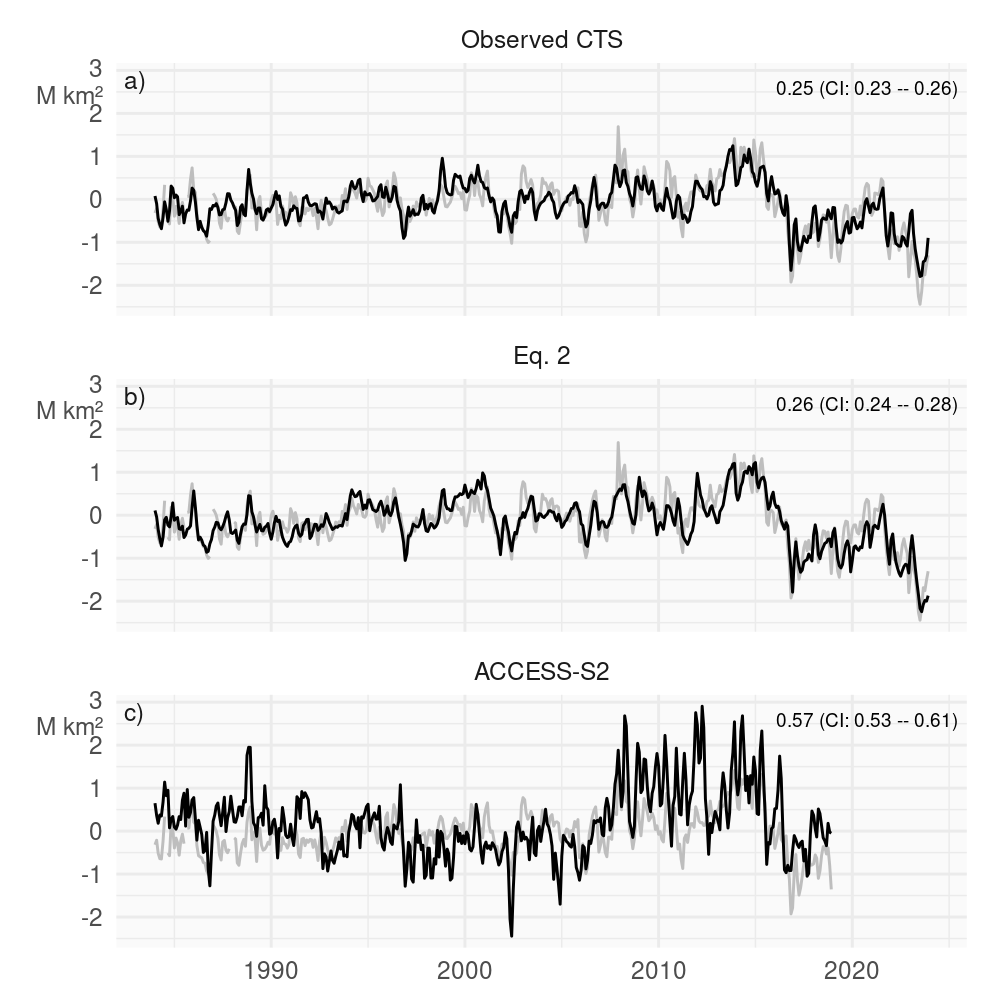
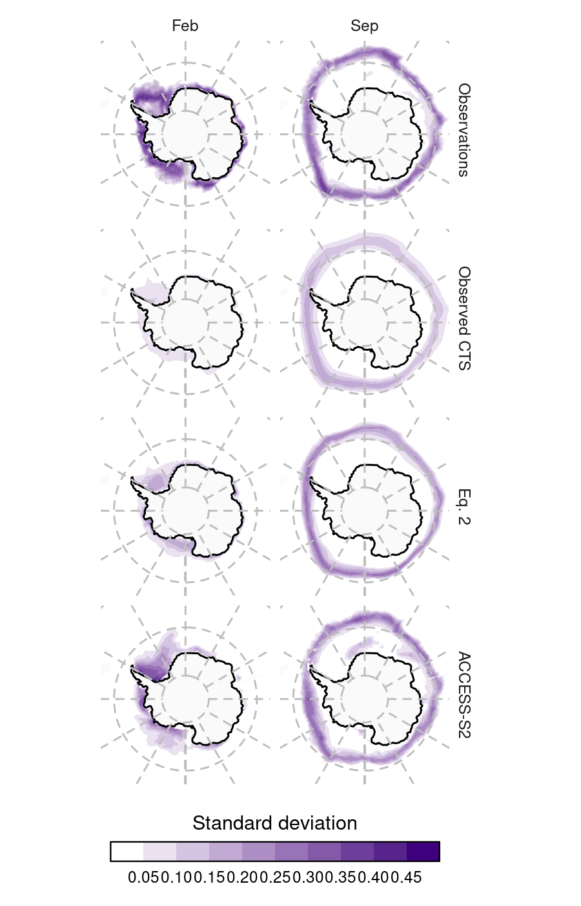
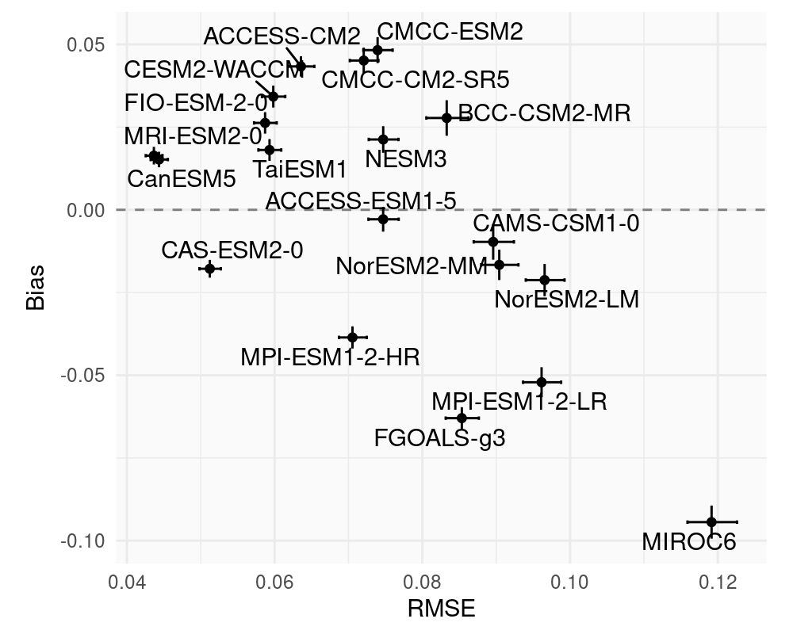
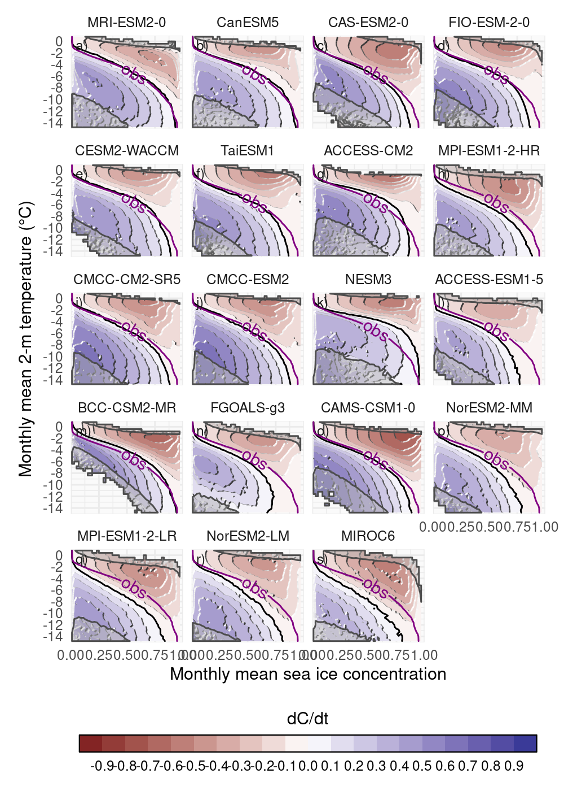
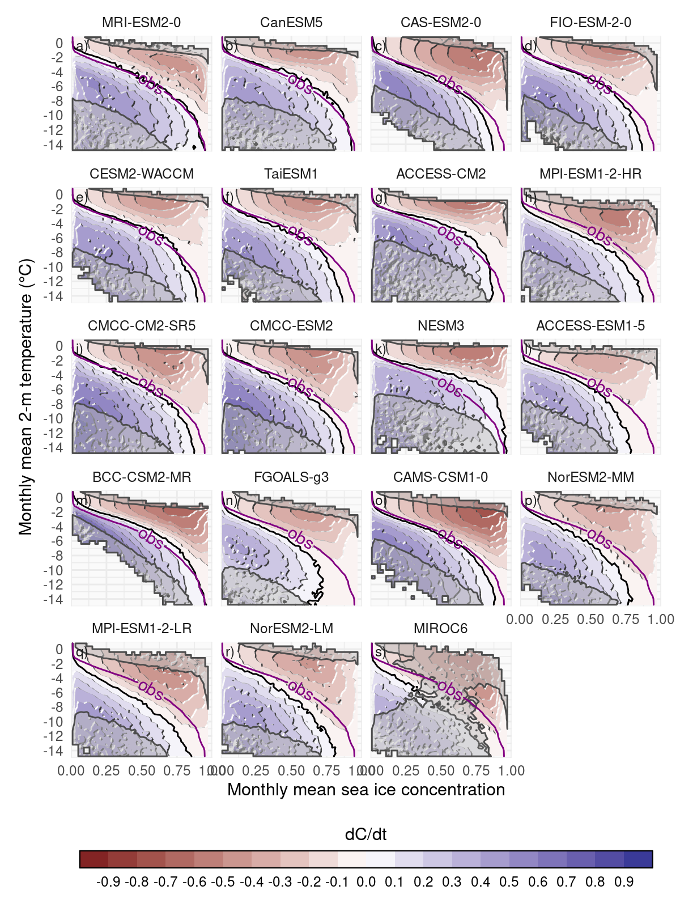
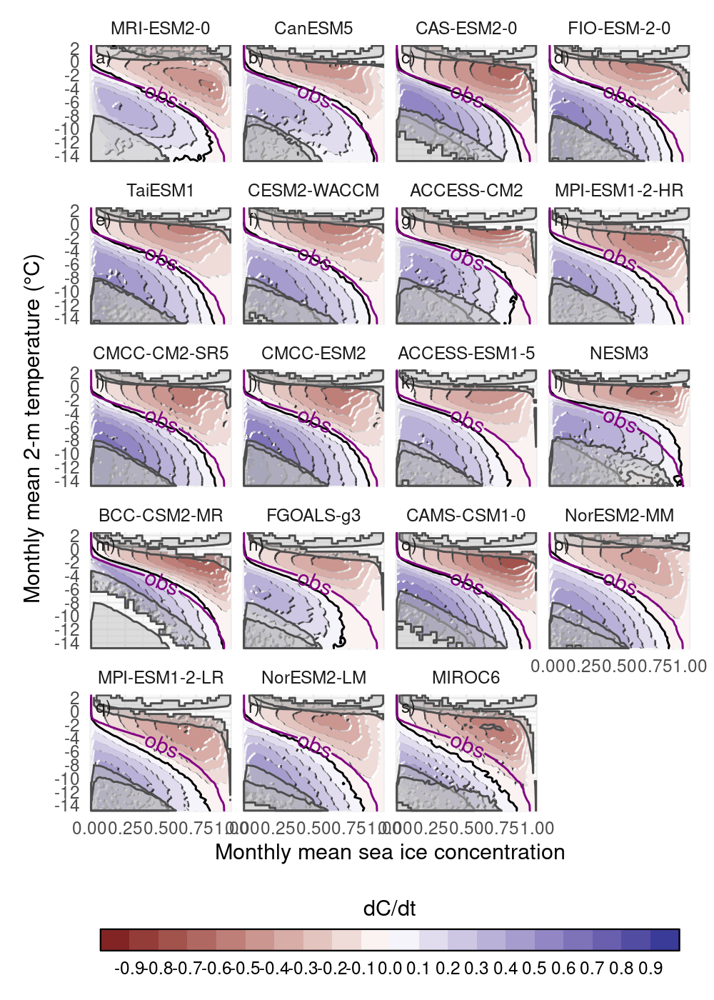

## Abstract

The typical monthly sea ice concentration tendency as a joint function of 2-metre air temperature and sea ice concentration itself defines a Concentration Tendency Surface (CTS).
This simple thermodynamic model predicts that sea ice concentration melt is minimum at high concentrations due to the insulation effect of sea ice itself, and at low concentrations because of the lack of sea ice to melt.
It predicts maximum sea ice concentration growth at low concentrations, when the ocean surface is exposed to cold air and there is available open water to freeze.
The CTS estimated from ERA5 and satellite observations follows these predictions and explains about half of the variance in sea ice concentration tendency.
At high concentrations, however, sea ice melts at temperatures well below the freezing point of ocean water.
Either ocean processes or higher-frequency fluctuations seem able to explain this phenomenon.
Forward integration of the estimated CTS reproduces a realistic seasonal cycle and interannual variability, including the decline in sea ice area after 2015.
CTS errors in CMIP6 models are strongly predictive of errors in seasonal sea ice area.
The Concentration Tendency Surface is therefore a promising, physically interpretable tool to evaluate models and can separate errors in ice thermodynamics from errors in atmospheric

<!-- 
## plain-language-summary

Short summary (500 char)

Half of the variability in monthly sea ice concentration change can be explained by the joint effect of near-surface air temperature and the insulation of sea ice. 
This relationship highlights that high sea ice concentration tend to decreases even at temperatures well below freezing. 
Climate models that simulate this relationship well tend to simulate a better sea ice seasonal cycle, suggesting that model error is due to errors in the sea ice model rather than the air temperature forcing it.
-->

# Introduction

Antarctic sea ice area experienced a gradual increase from 1979 onwards until a sudden collapse in 2015 (@turner2017) followed with record-low anomalies thereafter.
As well as a dramatic shift to a low mean, there is evidence that other properties of the sea ice system have also changed [@purich2023; @raphael2025], suggesting that sea ice might have experienced an abrupt critical transition [@hobbs2024] with the potential of being irreversible in human timescales.
But our understanding of sea ice variability is hampered by the relatively short observational record. 

Sea ice models could help us contextualise the scant observations available.
However, state-of-the-art climate models struggle to simulate the observed Antarctic sea ice mean state and variability [@roach2020; @roach2026] due to inadequate representation of key sea ice processes, external atmospheric or oceanic forcing, or both.
There is some evidence that incorrect representation of atmospheric trends plays a role [@purich2016].
By nudging model winds toward observations above 850 hPa, @espinosa2024 was able to simulate the record-low sea ice extent in 2023, although not the preceding positive trends or the decrease after 2015.
On the other hand, @roach2023 were able to reproduce sea ice expansion via wind forcing, but not the post-2015 decline.
Earlier, @blanchard-wrigglesworth2021 used the same methods to improve Antarctic sea ice trends in the CESM model, including the expansion in 1990--2015 and the post-2015 decline.
However, mean state biases were not significantly affected and the model simulated a strong decrease in the 1980--1990 period that was incompatible with observations.
They concluded that model biases come from problems in the model's ice thermodynamics and not from biased winds.

A simplified model of sea ice area evolution that can effectively separate errors due to the response of sea ice to atmospheric forcing from errors in the atmospheric forcing itself could help to better evaluate these model deficiencies. 
Considerable work has gone into developing theoretical models of floe thickness evolution based on the heat exchange through the ice [@thorndike1992; @lepparanta1993; @jones2025].
However, these do not simulate sea ice area, which is the main diagnostic of Antarctic sea ice.
The focus on sea ice area is due in part to observational constraints, as it is much easier to detect the presence and absence of sea ice than it is to estimate its thickness.
But the area covered by sea ice is also physically relevant because the effect of sea ice on albedo and heat transfer depends only weakly on thickness beyond a few centimetres [@makshtas1991].
A theoretical model of sea ice concentration (and thus area) would capture properties of sea ice most relevant to climate, while also being directly comparable both with observations and model output.

Sea ice grows and melts as the ocean loses or gains heat to the atmosphere, so near-surface air temperature is a crucial variable to predict sea ice evolution.
Since sea ice insulates the ocean from the atmosphere, heat transfer between the ocean and the atmosphere also depends on the sea ice cover.
A region with high sea ice cover will exchange little heat with the atmosphere even in the presence of a strong temperature difference, whereas one with large areas of open water will experience strong heat fluxes even with mild temperature differences.
Furthermore, sea ice concentration is bounded, which means that low or high air temperatures can only have an effect where there's open water to freeze or sea ice to melt respectively.
This means that the state of the sea ice itself is an important factor that modulates the net effect of any air temperature forcing and that the relationship between air temperature and sea ice concentration cannot be linear.

Dynamically, sea ice is in constant motion, so advection and divergence of sea ice floes will affect sea ice concentration locally without thermodynamic melt or freeze [@holland2012].
Internal ice processes such as sea ice ridging and rafting can also change sea ice concentration by redistributing sea ice volume within a cell.
These are important locally but do not affect the total sea ice area except through indirect feedbacks.
Thermodynamically, horizontal and vertical heat fluxes within the ocean will affect sea ice evolution.
These processes do affect total area and are deemed to be important, especially in the recent low sea ice state [@purich2023].
In this work, they will not be studied in order to isolate the atmospheric contribution specifically.

Here I define a Concentration Tendency Surface (CTS) as the mean change of sea ice concentration within a grid cell as a joint function of 2-metre air temperature and sea ice concentration.
I derive a simple analytical expression for this Surface from first principles and then estimate it from observations.
Identifying regions of discrepancy provides intuition of the effect of the missing processes in this simple model.
I explore the validity of the Concentration Tendency Surface by integrating it forward using observed 2-metre temperature forcing.
Finally, I evaluate the Concentration Tendency Surface of CMIP6 models to investigate if errors in this thermodynamic relationship are indicative of errors in the simulated sea ice.

::: {.cell layout-align="center"}

:::

::: {.cell layout-align="center"}

:::

::: {.cell layout-align="center"}

:::

::: {.cell layout-align="center"}

:::

# Data and Methods

I use Antarctic sea ice concentration from NOAA/NSIDC's Climate Data Record V4 [CDR; @meier2014].
This dataset takes the maximum value of the NASA Team [@cavalieri1984] and NASA Bootstrap [@comiso2023] sea ice concentration products to reduce their low concentration bias [@meier2014; @meier2021].
Both source algorithms use data from the Scanning Multichannel Microwave Radiometer (SMMR) on the Nimbus-7 satellite and from the Special Sensor Microwave/Imager (SSM/I) sensors on the Defense Meteorological Satellite Program's (DMSP) -F8, -F11, and -F13 satellites.
The data have a spatial resolution of 25 by 25 km on a stereographic projection and are available daily from November 1978 onwards.
Monthly values are obtained by averaging the daily record, and the analysis is restricted to the period 1981--2023 to avoid the early years that used interpolated data every other day.
I compute monthly sea ice tendency as the difference between sea ice concentration at one month and the next.

I use monthly mean 2-metre air temperature and Sea Surface Temperature (SST) from ERA5 [@hersbach2020] for the same period.
Both variables are bilinearly interpolated to the CDR grid prior to analysis.
In addition to the monthly mean, I also compute the monthly standard deviation of 2-metre air temperature from daily mean values.

::: {.cell layout-align="center"}

:::

To estimate the empirical Concentration Tendency Surface, I group all grid cells and all months according to their 2-metre air temperature and sea ice concentration and compute the average sea ice tendency.
Temperature is binned at 0.4°C intervals and sea ice concentration at 2% intervals.
For numerical integration, regions of the temperature-sea ice concentration space with fewer than 50 observations are imputed using the nearest values with more than 50 observations after applying a 2D locally-weighted regression (LOESS).
Theoretical CTSs are estimated by fitting their free parameters to observations by nonlinear squares [@bates1988] using the minpack.lm R package [@R-minpack.lm]. 
Only data before 2014 is used for fitting and a random sample of 1 million gridpoint-months are used for speed. 

The CTS-based prognostic models are integrated forward in time using a fourth-order Runge-Kutta scheme forced by monthly mean 2-metre temperature from ERA5.
Integrations are initialised from observed January 1983 sea ice concentrations and run to December 2023.
I compare those results with the ensemble mean 1-month lead time sea ice concentration hindcasts from the ACCESS-S2 coupled seasonal prediction system [@wedd2022] of the Australian Bureau of Meteorology.

::: {.cell layout-align="center"}

:::

Finally, I compute CTS of historical CMIP6 simulations [@eyring2016] (1850--2014) and the SSP5-8.5 scenario (2015--2100) [@oneill2016].
Models with monthly sea ice concentration and near-surface temperature available for both experiments are used.
All models and variables are bilinearly interpolated to a 1° grid and restricted to the Southern Ocean south of 50°S.
Only the first ensemble member (r1i1p1f1) is used.
The 17 models analysed are: ACCESS-CM2, ACCESS-ESM1-5, BCC-CSM2-MR, CAMS-CSM1-0, CanESM5, CAS-ESM2-0, CESM2-WACCM, CMCC-CM2-SR5, CMCC-ESM2, FGOALS-g3, FIO-ESM-2-0, MIROC6, MPI-ESM1-2-HR, MPI-ESM1-2-LR, MRI-ESM2-0, NESM3, NorESM2-LM, NorESM2-MM, and TaiESM1.

## Computational procedures

I performed all analyses in this paper using the R programming language [@rcoreteam2000], using data.table [@barrett2006] and metR [@campitelli2018c] packages.
Significant processing was performed using the CDO command line operators [@schulzweida2023] via the rcdo R package [@campitelli2025b].
Sea ice models were written in C++ for speed and integrated in R using the Rcpp package [@eddelbuettel2008].
All graphics are made using ggplot2 [@wickham2009].
The paper was rendered using knitr and Quarto [@xie2017; @allaire2022].

# Results

## Theoretical model of sea ice concentration change

I start with a simplified model of sea ice growth and melt.
In this model, each cell has an area of water and an area covered with ice.
Assuming that sea ice is a perfect insulator, the ocean surface exchanges heat with the atmosphere only over the ice-free surface.
This heat flux is parameterised with a bulk formula as a function of air-sea temperature difference and a constant exchange coefficient (the effect of frictional wind is omitted for simplicity).
Sea surface temperature is assumed to be constant and equal to the freezing point.
This latter assumption is justified by the fact that a mixture of water and ice in thermodynamic equilibrium will stay at the freezing point, and any heat gain or loss will either melt ice or freeze ocean water. The full formula for the heat exchange at each grid cell is then

$$
F = \alpha (T_a - T_f) (1 - C)
$$ {#eq-flux}

where $T_f$ and $T_a$ are the freezing-point temperature of the ocean and the temperature of the atmosphere, respectively; $C$ is the proportion of the grid cell covered with ice; and $\alpha$ is a proportionality constant.
Note that in practice, $T_f$ will be an effective temperature fitted from observations.

To relate heat flux to sea ice concentration change, I assume that $F$ is proportional to the proportion of sea ice melted or ice-free ocean frozen, $F_{p}$.

$$
F_{p} = \frac{F} {(1 + \left| F \right |)}
$$

This transformation ensures that $F_p$ is bounded between $-1$ and $1$ and parameterises a saturation point beyond which extremely strong fluxes will be partially counteracted by other processes, such as horizontal and vertical transport of heat within the top layer of the ocean.
If $F_p$ is negative, heat lost to the ocean is balanced by freezing, therefore the change in sea ice concentration is

$$
\frac{dC}{dt} = -\beta_f F_{p} (1 - C)
$$

where $\beta_f$ is a freezing proportionality constant.

Conversely, if $F_p$ is positive, heat gained by the ocean goes to melting.
In this case it is only ice-covered areas which can melt, making the change in sea ice concentration proportional to sea ice concentration itself.

$$
\frac{dC}{dt} = -\beta_m F_{p} C
$$

where $\beta_m$ is a melting proportionality constant that in principle could be different from $\beta_f$.

The full model, therefore, is

$$
\frac{dC}{dt} =
\begin{cases}
\frac{-\beta_f \alpha (T_a - T_f) (1 - C)^2 }{ 1 + \alpha (T_a - T_f) (1 - C)}    &  T_a \le T_f, \\
\frac{-\beta_m \alpha (T_a - T_f) (1 - C) C }{ 1 + \alpha (T_a - T_f) (1 - C)}  &  T_a  > T_f
\end{cases}
$$ {#eq-model}

::: {.cell layout-align="center"}

:::

This simplified theoretical model implies a functional form of sea ice concentration tendency as a function of air temperature and sea ice concentration.
For conciseness, I will refer to this relationship as the Concentration Tendency Surface (CTS).

::: {.cell layout-align="center"}
::: {.cell-output-display}
{#fig-theory fig-align='center'}
:::
:::

To illustrate the basic properties of this simple model, @fig-theory shows the change in monthly sea ice concentration as a function of sea ice concentration for temperatures in the melting and freezing regimes.
Parameters are all set arbitrarily to 1.
For a given temperature below freezing (blue line), sea ice growth is maximum at low sea ice concentrations since that maximises both the heat loss and ice-free ocean that is available for freezing whereas at high sea ice concentrations heat fluxes are suppressed and there is little open water to freeze, leading to slow growth.
For a given temperature above freezing (red line), sea ice melt is slow both at low concentrations -- because there is little ice left to melt -- and at high concentrations -- because the ice insulates the ocean from the atmosphere.
Maximum melt is at around 60% sea ice concentrations, when there is enough ice to melt and enough ice-free ocean for the ocean to exchange heat.

## Observations

::: {.cell layout-align="center"}

:::

::: {.cell layout-align="center"}

:::

::: {.cell layout-align="center"}

:::

::: {.cell layout-align="center"}

:::

::: {.cell layout-align="center"}

:::

::: {.cell layout-align="center"}

:::

::: {.cell layout-align="center"}

:::

::: {.cell layout-align="center"}

:::

::: {.cell layout-align="center"}

:::

::: {.cell layout-align="center"}

:::

::: {.cell layout-align="center"}

:::

::: {.cell layout-align="center"}

:::

::: {.cell layout-align="center"}
::: {.cell-output-display}
{#fig-grid-sd fig-align='center'}
:::
:::

Before comparing the theoretical predictions with observations, it is appropriate to consider whether $dC/dt$ can be computed from sea ice concentration and 2-metre temperature at all.
Or, in other words, whether sea ice even has a definable Concentration Tendency Surface.
In order to do that, I compute the error in estimating $dC/dt$ as the average observed tendency as a function of these variables.
This error, computed as the variance of sea ice tendencies (excluding conditions where air temperature is greater than 0°C and no ice is present), is 0.160.
For comparison, the full variance of sea ice change is 0.232.
The Concentration Tendency Surface therefore explains 52% of the variance in sea ice concentration change, indicating that this can be a useful model of sea ice growth.

@fig-grid-sd shows the standard deviation of $dC/dt$ as a function of temperature and sea ice concentration and illustrates that this mean error is in no way homogeneous.
Both for low sea ice concentrations at higher temperatures, and for high sea ice concentration at low temperature the error is lower than 0.15.
The error increases to between 0.2 and 0.35 at temperatures between -5°C and -3°C and sea ice concentration below 0.75.
This suggests that ice dynamics and ocean processes are particularly important at these intermediate temperatures.

::: {.cell layout-align="center"}
::: {.cell-output-display}
{#fig-aice-lines fig-align='center'}
:::
:::

The basic properties of the simple CTS are compared with observations in @fig-aice-lines.
Observations are computed by averaging grid cells with temperatures of -7°C and -1°C $\pm$ 0.25°C and sea ice concentration values binned in boxes 2% wide.
Parameters of the theoretical CTS are fitted from observations.
The overall observed curve fits notably well with the simple theory in the melt regime.
Melt is zero at zero concentrations by mathematical necessity, but it is also low at high concentrations, showing the stabilisation effect of sea ice insulation.
At 100% sea ice concentrations, melt values are not exactly zero due to the binning -- which means that these values are actually the average of values between 95% and 100%.

In the growth regime, observations don't follow @eq-model model as well.
Although they show low growth at high concentrations and high growth at low concentrations, they deviate from the simple model in two significant ways.
First, at sea ice concentrations lower than 25%, growth starts to flatten out.
This could be due to missing processes, but it is also important to note that satellite observations are increasingly uncertain below \~15%.
Second, at high concentrations sea ice actually melts even at low temperatures.

::: {.cell layout-align="center"}
::: {.cell-output-display}
{#fig-daice-monthly fig-align='center'}
:::
:::

To understand this deficiency better, @fig-daice-monthly (panel a and b) shows the complete CTS for observations and the theoretical model.
The black line marks the "zero line" that divides sea ice growth from melt, which is an estimate of $T_f$ in @eq-flux.
Note that the best fit $T_f$ for @eq-model is -3.2°C.
Contrary to the model's assumption, this zero line is not constant and instead depends heavily on sea ice concentration.
At low concentration, air temperature just below -2°C is enough to cause sea ice growth on average, but as sea ice concentration increases, the air needs to be increasingly colder for ice not to melt.
At about 50% sea ice concentration, air temperature needs to be lower than -5°C for ice to grow.
This property cannot be captured by the model in @eq-model, which assumes that sea ice will grow whenever air temperature is below a constant temperature.

The freezing point of water depends on salinity and sea ice growth, and melt directly affect surface salinity by brine rejection and releasing fresh water.
This effect cannot explain the extreme values of $T_f$ estimated.
Another possible issue is the assumption that ocean temperatures are constant and near the freezing point of water.
Computing the Concentration Tendency Surface directly using the difference between 2-metre air temperature and SST results in almost the same relationship (@fig-daice-monthly-sst).

The theoretical model could be altered to try to account for this discrepancy to gain insights into what is causing it.
A direct refinement is to postulate an ad-hoc dependency of $T_f$ on sea ice concentration.
The black line in @fig-daice-monthly panel a is well modelled by the fourth-degree polynomial in @eq-tf-model, fitted by linear regression.

::: {.cell layout-align="center"}
$$
T_f = - 1.2 - 6.2C - 9.7C^2 + 27.9C^3 - 26.8C^4
$$ {#eq-tf-model}
:::

Replacing the constant $T_f$ in @eq-model with the expression in @eq-tf-model and fitting the parameters using observed data results in the CTS shown in @fig-daice-monthly panel c.
This model reproduces the dependency of $T_f$ on sea ice concentration by definition.
It also slightly overestimates the melt occurring at low temperatures at high sea ice concentrations and features a discontinuity in the derivative of $dC/dt$ with respect to sea ice concentration, creating a "kink" seen in @fig-aice-lines panel c.
More fundamentally, by virtue of being a wholly ad-hoc modification, it is not useful for understanding the physical processes that create this dependence.
It would be preferable to have a model in which the dependence of $T_f$ on sea ice concentration arises as an emergent property from physically motivated rules.

A physically-motivated addition to @eq-model is to include a positive heat flux representing warming of the water from below by mixing with relatively warmer subsurface water.
Under this formulation, ice would grow only if the freezing at the surface from the atmosphere was greater than the melting from the ocean, which would require more extreme air temperatures when ice insulation is higher at higher concentrations, thus allowing for melt at low temperatures with a constant $T_f$.
Both wind forcing and waves can induce mixing, and both are damped by the presence of sea ice; therefore, this flux should also be proportional to the ice-free area.
In this full model, the change in sea ice concentration is decomposed into changes due to air fluxes and ocean fluxes.

$$
\frac{dC}{dt} = \left.\frac{dC}{dt}\right|_a  + \left.\frac{dC}{dt}\right|_o 
$$

where $\left.\frac{dC}{dt}\right|_a$ is the concentration tendency induced by air fluxes computed from @eq-flux and $\left.\frac{dC}{dt}\right|_o$ is the bottom-ocean contribution.

$$
\left.\frac{dC}{dt}\right|_{o} = \beta_m F_{po} C 
$$

where $F_{po} = F_o/(1 + \left| F_o \right |)$ is the proportion of sea ice melted by the ocean flux, computed as $F_o = \gamma(1 - C)$.
The new parameter $\gamma$ modulates the strength of the flux.

The results for this model with parameters fitted to observations are shown in @fig-aice-lines d and @fig-daice-monthly d.
This model produces a $T_f$ dependency comparable with observations, although the exact shape is clearly not correct; it is too flat at low sea ice concentrations and too steep at high sea ice concentrations.

Alternatively, the dependence of $T_f$ on sea ice concentration might be explained by sub-monthly temperature variations.
At high sea ice concentration, daily temperature values above freezing can cause some melt while daily temperature values below freezing will have little effect.
Through this non-linearity, daily variability could cause a net decrease in sea ice concentration even if the monthly mean value is well below freezing.
One limitation with this argument is that the same effect would cause net sea ice growth even in monthly mean temperatures above freezing.
However, observations show that the monthly standard deviation of daily air temperature is considerably higher when the monthly mean is below freezing (@fig-t2m_sd).

I simulate the effect of sub-monthly variations by running @eq-model 5000 times for each monthly mean 2-metre temperature and monthly mean sea ice concentration value including a random perturbation to temperature from a normal distribution with mean zero and standard deviation taken from observations.
Random sub-monthly temperature fluctuations approximate $T_f$ well, but they underestimate sea ice growth at low sea ice concentrations (@fig-aice-lines e and @fig-daice-monthly e).

::: {.cell layout-align="center"}

:::

::: {.cell layout-align="center"}

:::

Since the Concentration Tendency Surface defines a prognostic equation of sea ice concentration, it can be integrated forward in time using temperature fields as forcing.
This can help to indicate what aspects and regions of sea ice variability can be explained by the Concentration Tendency Surface.
By integrating both the Concentration Tendency Surface from @eq-model and the observed one (@fig-daice-monthly panels b and a, respectively), I can further analyse the impact of not taking the dependency of $T_f$ on sea ice concentration into acount. 
The observed Concentration Tendency Surface is not defined for unobserved values of sea ice concentration and temperatures, and it is highly uncertain in regions of that space with sparse observations.
To address both issues, I smooth the surface with a 2D LOESS fit, using only parts of the grid with more than 100 observations, and extend those values to regions with no data.
I use ERA5 2-m temperature as forcing and integrate the models using January 1983 observations as initial conditions and run them until December 2023. 
Note that since the CTS is computed from data before 2014, the period after that date can be considered out of sample. 
For comparison, I use sea ice concentration forecasts with a 1-month lead time by ACCESS-S2 [@wedd2022], the Bureau of Meteorology Subseasonal to Seasonal prediction model.

::: {.cell layout-align="center"}

:::

::: {.cell layout-align="center"}

:::

::: {.cell layout-align="center"}

:::

::: {.cell layout-align="center"}

:::

::: {.cell layout-align="center"}

:::

::: {.cell layout-align="center"}
::: {.cell-output-display}
{#fig-seasonal-cycle fig-align='center'}
:::
:::

The Concentration Tendency Surfaces simulates sea ice quite well compared with the coupled model.
@fig-seasonal-cycle shows the seasonal cycle of sea ice area for simulations based on @eq-model, the model based on observations, and the 1-month forecast from ACCESS-S2.
Both CTS-based models simulate a seasonal cycle of similar amplitude to observations, although in @eq-model the phase is shifted by about one month.
This is consistent with this model's flat $T_f$ .
In the observed CTS, sea ice can start to grow at temperatures above -3°C if concentrations are low enough, which is the case right after the February minimum.
But in @eq-model air temperatures need to get below that threshold, thus leading to a later start of the growing season.
Conversely, the observed CTS allows for melt to commence even when air temperatures are still far below freezing, whereas @eq-model requires temperatures above -3°C to initiate the melt season.

::: {.cell layout-align="center"}

:::

::: {.cell layout-align="center"}
::: {.cell-output-display}
{#fig-bias fig-align='center'}
:::
:::

Aggregated sea ice area can hide spatial variation in sea ice concentration biases, which are shown in @fig-bias. 
All three models show a strong low-concentration bias in the Weddell Sea in February, while the models based on Concentration Tendency Surfaces also exhibit a high-concentration bias in the Ross Sea.
It is likely that the lack of dynamical processes in these models is what is causing this bias.
If that is the case, then the fact that the coupled model shares the same feature suggests a problem in the dynamics of the model.
@eq-model also has positive biases in February around the rest of the continent, consistent with the out-of-phase seasonal cycle. 
In September the Observed CTS model has a positive bias along the ice edge and a negative bias within the ice pack. 
This simulation seems to have a more extensive ice cover but with lower average sea ice concentration. 
Omitted processes in this model seem to have the net effect of compacting sea ice. 
On the other hand, @eq-model has smaller biases, with more sea ice than observations in the Indian sector and less in the east of the Weddell Gyre. 

::: {.cell layout-align="center"}
::: {.cell-output-display}
{#fig-area-anomalies fig-align='center'}
:::
:::

Despite large local biases, the CTS-based models simulate sea ice area anomalies remarkably well (@fig-area-anomalies).
Both the observed CTS and the CTS fitted to @eq-model reproduce the overall observed variability, including the long-term increase followed by the sudden decrease in 2015 and the next decade of low sea ice.
While this suggests that these trends could be explained by atmospheric forcing alone, it is important to note that the observed temperature fields used for forcing will inevitably carry an imprint of the observed sea ice concentraion anomalies.
The overall error of the CTS-based models is significantly lower than the ACCESS-S2 error.
Note that the ACCESS-S2 system does not assimilate sea ice concentration observations but does assimilate temperature data [@campitelli2026], making it a relatively fair comparison.

::: {.cell layout-align="center"}

:::

::: {.cell layout-align="center"}
::: {.cell-output-display}
{#fig-spatial-cor fig-align='center'}
:::
:::

@fig-spatial-cor shows the correlation of sea ice anomalies for February and September.
In summer, all simulations have comparably low correlation values; however, in spring, the CTS-based models show higher correlation than the coupled model at the ice edge, although correlations are near zero in the core of the ice pack.
This is likely related to the low variance of sea ice concentrations in that region, where it is almost 100% every September [Fig. @fig-sd].

::: {.cell layout-align="center"}
::: {.cell-output-display}
{#fig-sd fig-align='center'}
:::
:::

While the CTS-based models perform well in terms of correlation and Pan-Antarctic sea ice area, one important limitation is that the variability of the simulated sea ice concentrations is much lower than that of either observations or the coupled model simulation (@fig-sd).
Lower variability is not unexpected since the Concentration Tendency Surface omits many sources of variability such as advection, divergence, thickness redistribution, and ocean processes.
This lack of variability in sea ice concentration does not translate to lower variability in sea ice area, indicating that regional anomalies largely compensate each other when aggregated.

# Concentration Tendency Surface in CMIP6 models

The observed Concentration Tendency Surface is an emergent property of thermodynamic processes and interactions between sea ice and the atmosphere.
To the extent that climate models represent these correctly, they should simulate a CTS similar to the observed one, thus motivating the use of CTS as a model evaluation framework.

::: {.cell layout-align="center"}

:::

::: {.cell layout-align="center"}

:::

::: {.cell layout-align="center"}
::: {.cell-output-display}
{#fig-cmip-historical fig-align='center'}
:::
:::

@fig-cmip-historical shows the CTS of the selected CMIP6 models computed using the historical simulations. 
The overall shape of the CTS is similar in all models and consistent with observations, including the dependency of $T_f$ on sea ice concentrations.
In most models, $T_f$ is colder than observations, meaning that they lose sea ice at lower temperatures. 
A particularly dramatic example is MIROC6 ([Fig. @fig-cmip-historical] panel s), which loses ice on average at temperatures as cold as -6°C at 50% sea ice concentration.
NESM3 is the only model with a significantly warmer $T_f$ ([Fig. @fig-cmip-historical] panel j).
In other models, such as MRI-ESM2.0, CanESM5 and CAS-ESM2.0, the $T_f$ zero line follows observations remarkably well.
Models' CTSs are stable in time and do not differ substantially between early in historical simulations ([Fig. @fig-cmip-historical_old]), late ([Fig. @fig-cmip-historical_new]) or SSP5-8.5 scenario ([Fig. @fig-cmip-ssp585]).

::: {.cell layout-align="center"}
::: {.cell-output-display}
{#fig-rmse-bias fig-align='center'}
:::
:::

Beyond $T_f$, models have slightly different sensitivities in their response to temperature. 
CAMS-CSM1.0 ([Fig. @fig-cmip-historical] panel o), for example, appears to simulate stronger melt and growth than observed, and the CMCC family of models ([Fig. @fig-cmip-historical] panels g and h) simulates stronger growth.
@fig-rmse-bias shows the bias and RMSE of each model's CTS compared with observations. 
Of the 19 evaluated models, 8 have an overall negative bias and 10 have a positive bias. 
For ACCESS-ESM1.5, even though its zero line is slightly cold ([Fig. @fig-cmip-historical] panel i) and it stands in the middle of the pack in terms of RMSE, negative and positive errors are compensated, leading to statistically zero bias.
The magnitude of positive biases is similar to the magnitude of negative biases, and the average bias across models is -0 (CI: -0.02 -- 0.02), indicating that neither warm nor cold models dominate.
Furthermore, there does not appear to be a strong relationship between bias and RMSE.
MIROC6 is an outlier in that regard, with very large error and negative bias.

::: {.cell layout-align="center"}

:::

::: {.cell layout-align="center"}
::: {.cell-output-display}
{#fig-cmip-errors fig-align='center'}
:::
:::

To relate errors in the CTS with errors in model representation of sea ice, @fig-cmip-errors compares the RMSE and bias of CTS with the respective error measures in the sea ice area seasonal cycle.
Errors in the CTS are highly predictive of errors in the seasonal cycle across models, with about 60% of the variance in seasonal cycle error attributable to CTS error.
On the other hand, CTS bias is less predictive of seasonal cycle bias.
Only 24% of bias variance is explained by CTS bias and almost all models have a negative sea ice bias regardless of the sign of the CTS bias.
From the spread in @fig-cmip-errors panel b, a model with zero CTS bias would still simulate sea ice with an area about 3$Mkm^2$ smaller than observations.
Models with positive CTS bias, such as CESM2-WACCM or ACCESS-CM2, compensate for this error and produce less biased sea ice, but they seem to be doing so for the wrong reasons.

# Conclusions

In this paper I describe the monthly change in Antarctic sea ice concentration as a function of 2-metre air temperature and sea ice concentration.
This defines a Concentration Tendency Surface (CTS) that attempts to encapsulate sea ice thermodynamic response to air temperature.
The high percentage of variance explained by the CTS (52%) suggests that this is a physically meaningful relationship and that sea ice response to air temperature accounts for a large proportion of variability in sea ice.
The large CTS errors at temperatures around -4°C and below 75% sea ice concentration can help identify particular regimes in which air temperature is less predictive of sea ice. 
Recognising events and regions where the CTS mispredicts sea ice evolution can also be valuable, as comparing them with events and regions where the CTS does well could shed light on the atmospheric and oceanic conditions in which dynamic effects dominate over the thermodynamics.

Sea ice concentration evolution depends strongly on ice state itself, consistent with the insulation and geometric effects predicted by a simple model the CTS.
However, these processes alone cannot account for the observed melt at very low air temperatures when concentrations are high.
Without this phenomenon, equilibrium sea ice concentration at temperatures lower than the freezing point would be 100%.
Instead, observations show that there is an additional nonlinear mechanism that can sustain some open water even at extremely cold conditions.
Simple modelling suggests that ocean upwelling might be an explanation, but stochastic air temperature fluctuations at the daily level can also be playing a role. 

The fact that forward integration of the CTS prognostic equation can not only reproduce a realistic seasonal cycle but also the variability and trends of pan-Antarctic sea ice area suggests that air temperature plays a crucial role in determining total area. 
Other mechanisms are important mostly for local variability, as evidenced by the low variability in sea ice concentration simulated by the CTS models. 
A potential limitation is that observed 2-metre temperatures might be driven by the change in sea ice itself and are informing the model.
Comparing a CTS integration with the results of an ocean model forced with prescribed temperatures could be a useful next step to further clarify this point.

Some of the biases reproduced by the CTS equation are comparable to the biases in the ACCESS-S2 coupled model.
This suggests that, in the coupled model, they arise from issues in the processes omitted in the CTS.
Comparing CTS between models and observations allows us to evaluate the model's sea ice response to forcing.
It also enables evaluation of the model's variability without requiring the timing of the variability to match with observations.
CMIP6 model errors are well correlated with CTS errors, indicating that they arise primarily due to inaccurate sea ice response and not due to inaccurate atmospheric conditions.
Surprisingly, although most models have less ice than observations, about half of the models have a positive CTS bias. 
This group of models has the lowest sea ice bias, suggesting that errors in sea ice thermodynamics might be compensating for errors in the air temperature forcing, thus simulating a less biased sea ice area but for the wrong reasons. 
However, this only applies to the seasonal cycle and not necessarily to trends.
Further study should look at the potential utility of the CTS framework for constraining future projections.

While this estimation of the CTS was shown to be useful, there are several potential modifications to better represent and isolate the thermodynamic effects from other sources of variability.
In this work I estimated sea ice concentration tendency by a simple difference between months, but this conflates freezing and melting with contributions from sea ice advection and divergence.
A cleaner division could be achieved by dividing the sea ice evolution into the dynamic and thermodynamic parts [@holland2012] and then using only the latter.
The bulk formula for heat transfer implied in @eq-model also depends on the magnitude of the wind friction, but this is not included in the present analysis.
Taking wind into account would involve adding a third dimension to the diagnostic, making visual interpretation more difficult; further work is needed to determine if this is an acceptable trade-off.
Finally, analysing the CTS based on daily sea ice change could help better understand the role of submonthly fluctuations.

The prognostic equation derived from the CTS offers a plausible route towards building a coupled nonlinear model that could be used to explicitly analyse bifurcations in the sea ice system, contributing to our understanding of recent sea ice trends.
Further refinements that include the effect of sea ice albedo on air and ocean temperature and the effect of brine rejection and ice melt on salinity are needed reach that goal. 

\FloatBarrier

\clearpage

# Appendix A {.appendix}

\appendixfigures

::: {.cell layout-align="center"}
::: {.cell-output-display}
{#fig-daice-monthly-sst fig-align='center'}
:::
:::

::: {.cell layout-align="center"}
::: {.cell-output-display}
{#fig-t2m_sd fig-align='center'}
:::
:::

::: {.cell layout-align="center"}
::: {.cell-output-display}
{#fig-cmip-historical_old fig-align='center'}
:::
:::

::: {.cell layout-align="center"}
::: {.cell-output-display}
{#fig-cmip-historical_new fig-align='center'}
:::
:::

::: {.cell layout-align="center"}
::: {.cell-output-display}
{#fig-cmip-ssp585 fig-align='center'}
:::
:::

