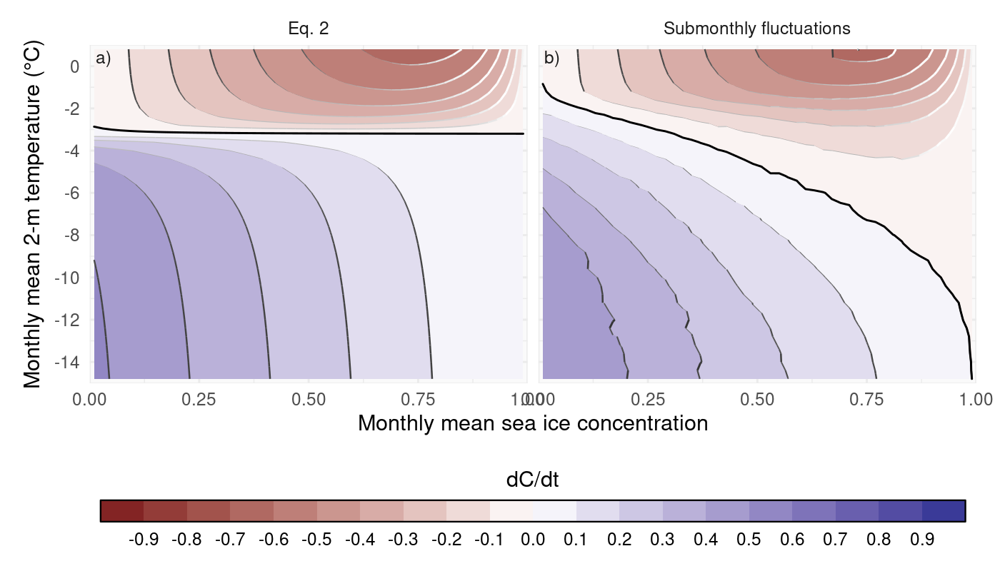
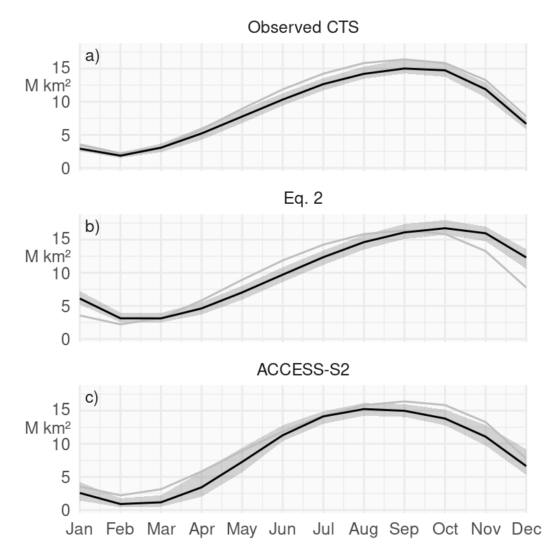
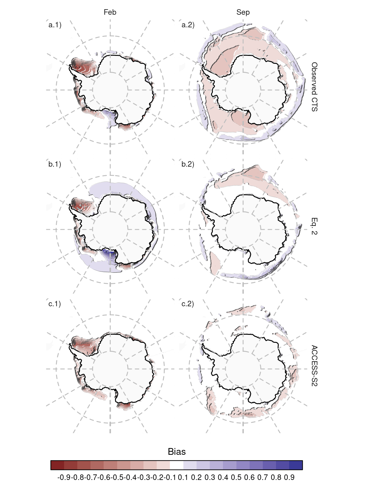
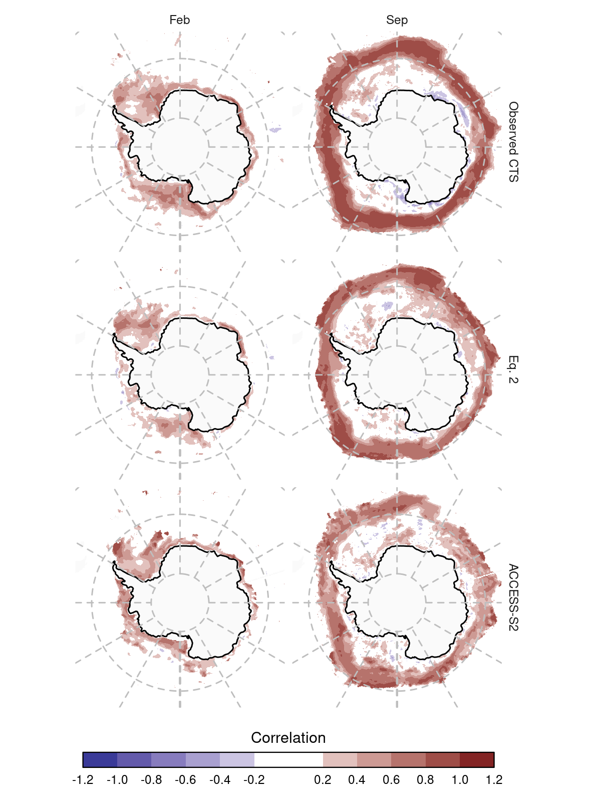
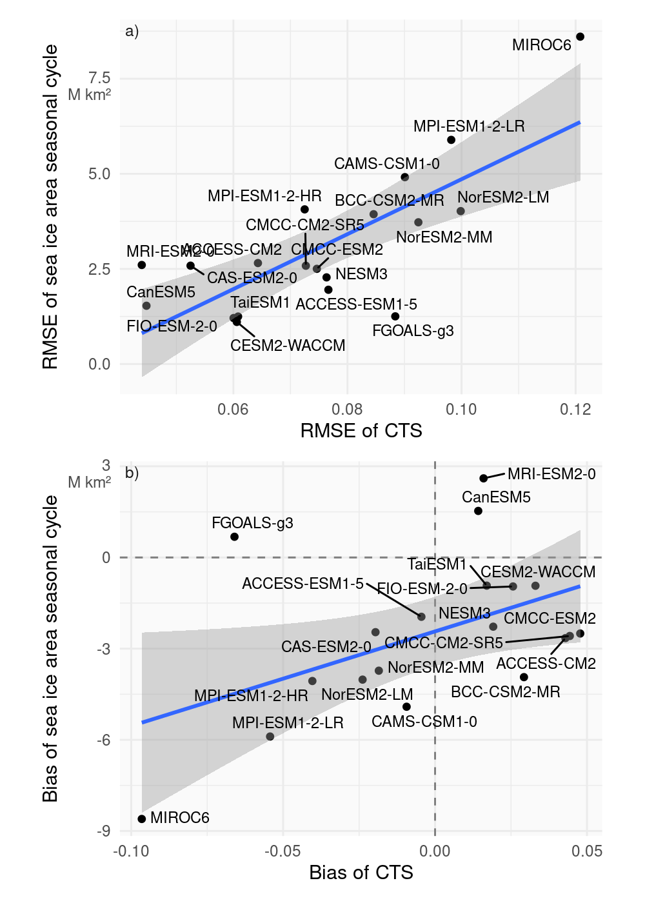
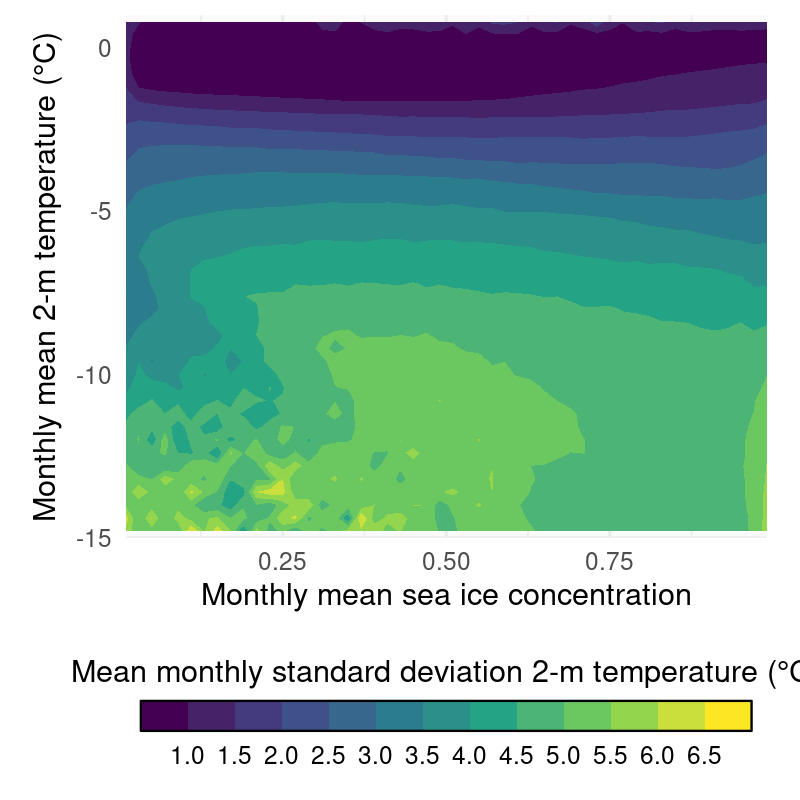
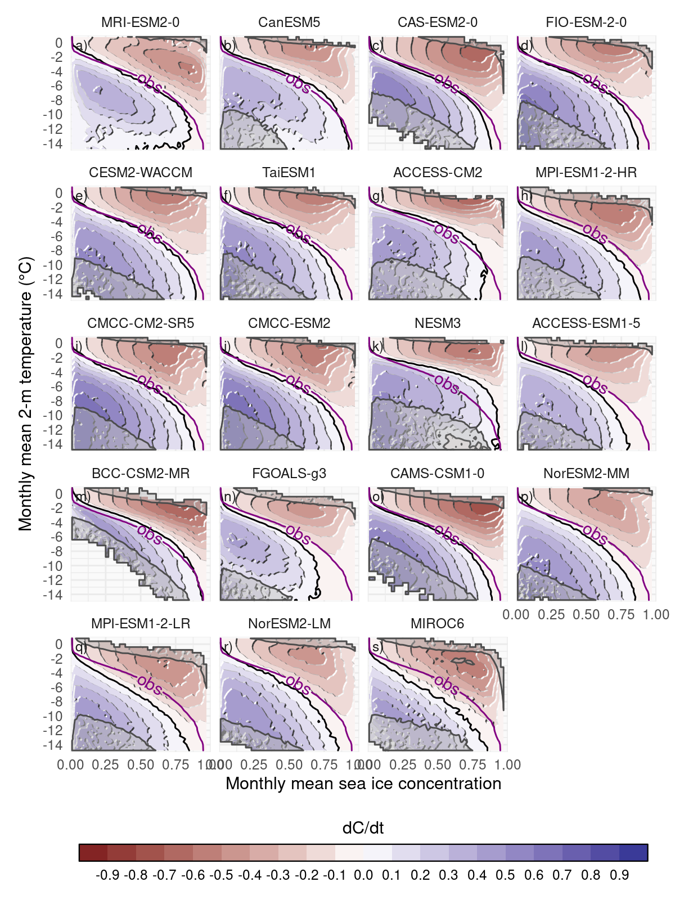

## Abstract

Climate models struggle to simulate observed Antarctic sea ice seasonality and trends.
To separate errors in how models represent sea ice from errors in their atmospheric forcing, I define a Concentration Tendency Surface (CTS): the mean monthly change in sea ice concentration as a joint function of 2-metre air temperature and sea ice concentration itself.
The CTS estimated from ERA5 and satellite observations explains about half of the variance in monthly concentration tendency. At high temperatures, concentration loss is smallest at both high and low concentrations, and at low temperatures growth is greatest at low concentrations, as expected from the insulating effect of sea ice and the bounded nature of concentration.
At high concentrations sea ice coverage decreases on average even when monthly mean air temperatures are well below freezing, which can be explained by the non-linear effect of daily temperatures. 
Forward integration of the estimated CTS reproduces a realistic seasonal cycle and interannual variability, including the decline in sea ice area after 2015.
In CMIP6 models, CTS errors explain more than half of the variance in errors of the seasonal cycle of sea ice area.
Therefore, the CTS is a physically interpretable diagnostic that is simple to compute in observations and model output, and that by evaluating processes rather than output, it can separate errors in sea ice response from errors in atmospheric forcing.

<!-- 
## plain-language-summary

Short summary (500 char)

Half of the variability in monthly sea ice concentration change can be explained by the joint effect of near-surface air temperature and the insulation of sea ice. 
This relationship highlights that high sea ice concentration tends to decrease even at temperatures well below freezing. 
Climate models that simulate this relationship well tend to simulate a better sea ice seasonal cycle, suggesting that model error is due to errors in the sea ice model rather than the air temperature forcing it.
-->

# Introduction

Antarctic sea ice area experienced a gradual increase from 1979 onwards until a sudden collapse in 2015 [@turner2017] followed by record-low anomalies thereafter.
As well as a dramatic shift to a low mean, there is evidence that other properties of the sea ice system have also changed [@purich2023; @raphael2025], suggesting that sea ice might have experienced an abrupt critical transition [@hobbs2024] with the potential of being irreversible in human timescales.
But our understanding of sea ice variability is hampered by the relatively short observational record. 

Sea ice models could help us contextualise the scant observations available.
However, state-of-the-art climate models struggle to simulate the observed Antarctic sea ice mean state and variability [@roach2020; @roach2026] due to inadequate representation of key sea ice processes, external atmospheric or oceanic forcing, or both.
There is some evidence that incorrect representation of atmospheric trends plays a role [@purich2016].
By nudging model winds toward observations above 850 hPa, @espinosa2024 was able to simulate the record-low sea ice extent in 2023, although not the preceding positive trends or the decrease after 2015.
On the other hand, @roach2023 were able to reproduce sea ice expansion via wind forcing, but not the post-2015 decline.
Earlier, @blanchard-wrigglesworth2021 used the same methods to improve Antarctic sea ice trends in the CESM model, including the expansion in 1990--2015 and the post-2015 decline.
However, mean state biases were not significantly affected and the model simulated a strong decrease in the 1980--1990 period that was incompatible with observations.
They concluded that model biases come from problems in the model's ice thermodynamics and not from biased winds.

A simple diagnostic of the response of sea ice concentration to atmospheric forcing that can effectively separate errors due to the response of sea ice to atmospheric forcing from errors in the atmospheric forcing itself could help to better evaluate these model deficiencies.
Concentration, and thus area, is the main diagnostic of Antarctic sea ice and the one best constrained by satellite observations, whereas thickness is much harder to observe. 
It is also climatically relevant, because the effect of sea ice on albedo and heat transfer depends only weakly on thickness beyond a few centimetres [@makshtas1991].
Since sea ice insulates the ocean from the atmosphere, heat transfer between the ocean and the atmosphere also depends on the sea ice cover.
This means that the state of the sea ice itself is an important factor that modulates the net effect of any air temperature forcing and that the relationship between air temperature and sea ice concentration cannot be linear.
Therefore, in this paper I will study the response of sea ice concentration to near-surface air temperature as a widely available forcing and to 

Here I define a Concentration Tendency Surface (CTS) as the mean change of sea ice concentration within a grid cell as a joint function of 2-metre air temperature and sea ice concentration.
I first estimate the CTS empirically from observations and quantify how much of the variability in monthly concentration tendency it explains.
I then formulate a minimal conceptual model that can help explain the main features of the observed CTS. 
I then explore how much of the observed variability in sea ice area the CTS can reproduce by integrating it forward using observed 2-metre temperature.
Finally, I evaluate the CTS of CMIP6 models to investigate if errors in this relationship are indicative of errors in the simulated sea ice.

::: {.cell layout-align="center"}

:::

::: {.cell layout-align="center"}

:::

::: {.cell layout-align="center"}

:::

::: {.cell layout-align="center"}

:::

# Data and Methods

I use Antarctic sea ice concentration from NOAA/NSIDC's Climate Data Record V4 [CDR; @meier2014].
This dataset takes the maximum value of the NASA Team [@cavalieri1984] and NASA Bootstrap [@comiso2023] sea ice concentration products to reduce their low concentration bias [@meier2014; @meier2021].
Both source algorithms use data from the Scanning Multichannel Microwave Radiometer (SMMR) on the Nimbus-7 satellite and from the Special Sensor Microwave/Imager (SSM/I) sensors on the Defense Meteorological Satellite Program's (DMSP) -F8, -F11, and -F13 satellites.
The data have a spatial resolution of 25 by 25 km on a stereographic projection and are available daily from November 1978 onwards.
Monthly values are obtained by averaging the daily record, and the analysis is restricted to the period 1981--2023 to avoid the early years that used interpolated data every other day.
I compute monthly sea ice tendency as the difference between sea ice concentration at one month and the next.
This tendency includes advection, divergence and ridging as well as thermodynamic change. 

I use monthly mean 2-metre air temperature and Sea Surface Temperature (SST) from ERA5 [@hersbach2020] for the same period.
Both variables are bilinearly interpolated to the CDR grid prior to analysis.
In addition to the monthly mean, I also compute the monthly standard deviation of 2-metre air temperature from daily mean values.

::: {.cell layout-align="center"}

:::

To estimate the empirical Concentration Tendency Surface, I group all grid cells and all months according to their 2-metre air temperature and sea ice concentration and compute the average sea ice tendency.
Temperature is binned at 0.4°C intervals and sea ice concentration at 2% intervals.
For numerical integration, regions of the temperature-sea ice concentration space with fewer than 50 observations are imputed using the nearest values with more than 50 observations after applying a 2D locally-weighted regression (LOESS).
The free parameters of the conceptual model described in the Results are estimated by fitting it to observations using non-linear least squares [@bates1988] and the minpack.lm R package [@R-minpack.lm]. 
Only data before 2014 is used for fitting and a random sample of 1 million gridpoint-months are used for speed. 

The CTS-based integrations are run forward in time using a fourth-order Runge-Kutta scheme forced by monthly mean 2-metre temperature from ERA5.
Integrations are initialised from observed January 1983 sea ice concentrations and run to December 2023.
I compare those results with the ensemble mean 1-month lead time sea ice concentration hindcasts from the ACCESS-S2 coupled seasonal prediction system [@wedd2022] of the Australian Bureau of Meteorology.

::: {.cell layout-align="center"}

:::

Finally, I compute CTS of historical CMIP6 simulations [@eyring2016] (1850--2014) and the SSP5-8.5 scenario (2015--2100) [@oneill2016].
Models with monthly sea ice concentration and near-surface temperature available for both experiments are used.
All models and variables are bilinearly interpolated to a 1° grid and restricted to the Southern Ocean south of 50°S.
Only the first ensemble member (r1i1p1f1) is used.
The 17 models analysed are: ACCESS-CM2, ACCESS-ESM1-5, BCC-CSM2-MR, CAMS-CSM1-0, CanESM5, CAS-ESM2-0, CESM2-WACCM, CMCC-CM2-SR5, CMCC-ESM2, FGOALS-g3, FIO-ESM-2-0, MIROC6, MPI-ESM1-2-HR, MPI-ESM1-2-LR, MRI-ESM2-0, NESM3, NorESM2-LM, NorESM2-MM, and TaiESM1.

## Computational procedures

I performed all analyses in this paper using the R programming language [@rcoreteam2000], using data.table [@barrett2006] and metR [@campitelli2018c] packages.
Significant processing was performed using the CDO command line operators [@schulzweida2023] via the rcdo R package [@campitelli2025b].
The CTS integrations were written in C++ and run from R using the Rcpp package [@eddelbuettel2008].
All graphics are made using ggplot2 [@wickham2009].
The paper was rendered using knitr and Quarto [@xie2017; @allaire2022].

# Results

::: {.cell layout-align="center"}

:::

::: {.cell layout-align="center"}

:::

::: {.cell layout-align="center"}

:::

::: {.cell layout-align="center"}

:::

::: {.cell layout-align="center"}

:::

::: {.cell layout-align="center"}

:::

::: {.cell layout-align="center"}

:::

::: {.cell layout-align="center"}

:::

::: {.cell layout-align="center"}

:::

::: {.cell layout-align="center"}

:::

## The empirical Concentration Tendency Surface

::: {.cell layout-align="center"}
::: {.cell-output-display}
{#fig-empirical-cts fig-align='center'}
:::
:::

In order to investigate whether observed monthly sea ice concentration tendencies, $dC/dt$, can be computed from sea ice concentration and 2-metre temperature at all, I compute the empirical CTS as the mean sea ice concentration tendency in 2-metre temperature and sea ice concentration bins. 
A measure of the error of this empirical model is the standard deviation of monthly sea ice concentration tendencies about the CTS.
Excluding conditions where air temperature is greater than 0°C and no ice is present, the standard deviation is 0.159.
For comparison, the full standard deviation of sea ice concentration tendencies is 0.231.
The Concentration Tendency Surface therefore explains 52% of the variance in sea ice concentration change. 
Thus these two variables are enough to explain a large proportion of sea ice concentration change. 

About half of the variance in $dC/dt$ remains unexplained and could be attributed to other variables and processes, such as ocean upwelling and sea ice dynamics. 
@fig-empirical-cts a shows the standard deviation of $dC/dt$ as a function of temperature and sea ice concentration and illustrates that the mean CTS error is in no way homogeneous.
Both for low sea ice concentrations at higher temperatures, and for high sea ice concentration at low temperature the error is lower than 0.15.
The error increases to between 0.2 and 0.35 at temperatures between -5°C and -3°C and sea ice concentration below 0.75.
This suggests that ice dynamics and ocean processes are particularly important at these intermediate temperatures.

The empirical CTS has a coherent structure (@@fig-empirical-cts b). 
As expected, sea ice concentration decreases at air temperatures above the freezing point of water and increases at air temperatures below it.
However, there is also a dependency in sea ice concentration. 
At high temperatures, $dC/dt$ is zero at zero sea ice concentration by mathematical necessity (since there is no sea ice to reduce), but it is also low at high concentrations. 
Maximum decrease in $dC/dt$ is seen at intermediate sea ice concentration values. 
At low temperatures, on the other hand, $dC/dt$ shows maximum increase at low sea ice concentrations. 
As sea ice concentration increases, $dC/dt$ is reduced until it reaches zero at an equilibrium temperature and then turns negative. 
The result is that at low sea ice coverage, air temperature just below -2°C is enough to cause sea ice concentrations to grow on average, but as coverage increases, the air needs to be increasingly colder for ice concentration to increase.
At about 50% sea ice concentrations, $dC/dt$ is negative even at temperatures well below the freezing point of ocean water.
This effect is defined by the black line in @fig-empirical-cts b that marks the equilibrium air temperature at which $dC/dt=0$ as a function of sea ice concentrations. 

## A conceptual model of the Concentration Tendency Surface

::: {.cell layout-align="center"}
::: {.cell-output-display}
{#fig-theory fig-align='center'}
:::
:::

The empirical result that sea ice concentration decreases on average at air temperatures below the freezing point might seem unphysical, but this can be explained by a minimal conceptual model of sea ice concentration tendency as a function of air temperature alone. 
In this model, each cell has an area of water and an area covered with ice with a prescribed average thickness.
At the simplest limit, I assume that the ocean exchanges heat with the atmosphere only and model it as a bulk formula only proportional to the temperature difference between the air and the mixed layer. 
Furthermore, sea surface temperature is assumed to be constant and equal to the freezing point. 
This latter assumption is justified by the fact that a mixture of water and ice in thermodynamic equilibrium will stay at the freezing point, and any heat gain or loss will either melt ice or freeze ocean water.
The heat exchange at each grid cell is then

$$
F = \alpha (T_a - T_b) (1 - C)
$$ {#eq-flux}

where $T_a$ is the temperature of the atmosphere, $C$ is the proportion of the grid cell covered with ice and $\alpha$ is a proportionality constant.
$T_b$ is the air temperature at which the net heat flux to the ocean is zero. 
In the absence of any unresolved processes or sources of heat, this would be the freezing point of ocean water. 
In practice I will treat it as an effective balance temperature that will be fitted from observations.

To relate heat flux to sea ice concentration change, I assume that $F$ is proportional to the proportion of sea ice melted or ice-free ocean frozen, $F_{p}$.

$$
F_{p} = \frac{F} {1 + \left| F \right |}
$$

This transformation ensures that $F_p$ is bounded between $-1$ and $1$ and parameterises a saturation point beyond which extremely strong fluxes will be partially counteracted by other processes, such as horizontal and vertical transport of heat within the top layer of the ocean.
If $F_p$ is negative, heat lost to the ocean is balanced by freezing, therefore the change in sea ice concentration is

$$
\frac{dC}{dt} = -\beta_f F_{p} (1 - C)
$$

where $\beta_f$ is a freezing proportionality constant.

Conversely, if $F_p$ is positive, heat gained by the ocean goes to melting.
In this case it is only ice-covered areas which can melt, making the change in sea ice concentration proportional to sea ice concentration itself.

$$
\frac{dC}{dt} = -\beta_m F_{p} C
$$

where $\beta_m$ is a melting proportionality constant that in principle could be different from $\beta_f$.

The full conceptual model is therefore

$$
\frac{dC}{dt} =
\begin{cases}
\frac{-\beta_f \alpha (T_a - T_b) (1 - C)^2 }{ 1 + \left | \alpha (T_a - T_b) (1 - C) \right |}  &  T_a \le T_b, \\
\frac{-\beta_m \alpha (T_a - T_b) (1 - C) C }{ 1 + \left | \alpha (T_a - T_b) (1 - C) \right |}  &  T_a  > T_b
\end{cases}
$$ {#eq-model}

This simple model is enough to explain a lot of the dependence of $dC/dt$ [@fig-theory a].
For a given temperature below $T_b$, $dC/dt$ is maximum at low sea ice concentrations because this maximises both the area through which the ocean loses heat and the ice-free ocean that is available for freezing. 
Sea ice growth is lower at high sea ice concentrations because heat fluxes are suppressed and there is little open water to freeze.
For a given temperature above $T_b$, sea ice melt is slow both at low concentrations -- because there is little ice left to melt -- and at high concentrations -- because the ice insulates the ocean from the atmosphere.
Maximum melt is at around 75% sea ice concentration, when there is enough ice to melt and enough ice-free ocean for the ocean to exchange heat.
The fitted value of $T_b$ in @eq-model is -3.17361°C, which is lower than the freezing point of ocean water. 
This is consistent with ocean processes upwelling heat, and thus requiring the atmosphere to be colder than the freezing point in order to maintain equilibrium. 

This model by itself does not explain the dependence of balance temperature with sea ice concentration, as $T_b$ is assumed to be constant. 
However, a key insight is that even when mean monthly temperature is below $T_b$, some individual days might be warmer or colder than this value and under @eq-model, the effect of these sub-monthly fluctuations in air temperature is not linear. 
At high sea ice concentrations, daily temperatures above freezing melt more sea ice than daily temperatures below freezing can freeze, leading to a net decrease in sea ice concentrations. 
The monthly mean effect of air temperature is not equal to the effect of monthly mean air temperature. 

I simulate the effect of sub-monthly variations by running @eq-model \ensuremath{10^{4}} times for each monthly mean 2-metre temperature and monthly mean sea ice concentration value including random perturbations to temperature from a normal distribution with mean zero and mean monthly standard deviation of daily 2-metre temperature taken from observations and computing the mean response.
@fig-theory b shows that addition of these random sub-monthly temperature fluctuations approximate the empirical balance temperature very well. 
This shows that the dependence of the balance temperature with sea ice concentration can be accounted for as an emergent property of non-constant air temperature throughout each month and the non-linear nature of the response of sea ice concentration to air temperature. 

## Forward integration of the Concentration Tendency Surface

::: {.cell layout-align="center"}

:::

::: {.cell layout-align="center"}

:::

Since the Concentration Tendency Surface defines a prognostic equation of sea ice concentration, it can be integrated forward in time using temperature fields as forcing.
This can help to indicate what aspects and regions of sea ice variability can be explained by the Concentration Tendency Surface.
By integrating both the conceptual model (@@fig-theory a) and the observed CTS (@@fig-empirical-cts a), I can further analyse the effect of the dependency of $T_b$ on sea ice concentration. 
The observed Concentration Tendency Surface is not defined for unobserved values of sea ice concentration and temperatures, and it is highly uncertain in regions of that space with sparse observations.
To address both issues, I smooth the surface with a 2D LOESS fit, using only parts of the grid with more than 100 observations, and extend those values to regions with no data.
I use ERA5 2-m temperature as forcing and integrate the models using January 1983 observations as initial conditions and run them until December 2023. 
Note that since the CTS is computed from data before 2014, the period after that date can be considered out of sample. 
For comparison, I use sea ice concentration forecasts with a 1-month lead time by ACCESS-S2 [@wedd2022], the Bureau of Meteorology Subseasonal to Seasonal prediction model.

::: {.cell layout-align="center"}

:::

::: {.cell layout-align="center"}

:::

::: {.cell layout-align="center"}

:::

::: {.cell layout-align="center"}

:::

::: {.cell layout-align="center"}

:::

::: {.cell layout-align="center"}
::: {.cell-output-display}
{#fig-seasonal-cycle fig-align='center'}
:::
:::

The CTS-based integrations simulate sea ice quite well compared with the coupled model.
@fig-seasonal-cycle shows the seasonal cycle of sea ice area for simulations based on the observed CTS, @eq-model, and the 1-month forecast from ACCESS-S2.
Both CTS-based integrations simulate a seasonal cycle of similar amplitude to observations, although in @eq-model the phase is shifted by about one month.
This is consistent with its constant $T_b$.
In the observed CTS, sea ice can start to grow at temperatures above -3°C if concentrations are low enough, which is the case right after the February minimum.
But in @eq-model air temperatures need to get below that threshold, thus leading to a later start of the growing season.
Conversely, the observed CTS allows for concentration loss to commence even when air temperatures are still far below freezing, whereas @eq-model requires temperatures above -3°C to initiate the retreat season.

::: {.cell layout-align="center"}

:::

::: {.cell layout-align="center"}
::: {.cell-output-display}
{#fig-bias fig-align='center'}
:::
:::

Aggregated sea ice area can hide spatial variation in sea ice concentration biases, which are shown in @fig-bias. 
All three models show a strong low-concentration bias in the Weddell Sea in February, while the models based on Concentration Tendency Surfaces also exhibit a high-concentration bias in the Ross Sea.
It is likely that the lack of dynamical processes in these models is what is causing this bias.
If that is the case, then the fact that the coupled model shares the same feature suggests a problem in the dynamics of the model.
@eq-model also has positive biases in February around the rest of the continent, consistent with the out-of-phase seasonal cycle. 
In September the observed CTS integration has a positive bias along the ice edge and a negative bias within the ice pack. 
This simulation seems to have a more extensive ice cover but with lower average sea ice concentration. 
Omitted processes in this model seem to have the net effect of compacting sea ice. 
On the other hand, @eq-model has smaller biases, with more sea ice than observations in the Indian sector and less in the east of the Weddell Gyre. 

::: {.cell layout-align="center"}
::: {.cell-output-display}
{#fig-area-anomalies fig-align='center'}
:::
:::

Despite large local biases, the CTS-based integrations simulate sea ice area anomalies remarkably well (@fig-area-anomalies).
Both the observed CTS and @eq-model reproduce the overall observed variability, including the long-term increase followed by the sudden decrease in 2015 and the next decade of low sea ice.
While this suggests that these trends could be explained by atmospheric forcing alone, it is important to note that the observed temperature fields used for forcing will inevitably carry an imprint of the observed sea ice concentration anomalies.
The overall error of the CTS-based integrations is significantly lower than the ACCESS-S2 error.
Note that the ACCESS-S2 system does not assimilate sea ice concentration observations but does assimilate temperature data [@campitelli2026], making it a relatively fair comparison.

::: {.cell layout-align="center"}

:::

::: {.cell layout-align="center"}
::: {.cell-output-display}
{#fig-spatial-cor fig-align='center'}
:::
:::

@fig-spatial-cor shows the correlation of sea ice anomalies for February and September.
In summer, all simulations have comparably low correlation values; however, in spring, the CTS-based integrations show higher correlation than the coupled model at the ice edge, although correlations are near zero in the core of the ice pack.
This is likely related to the low variance of sea ice concentrations in that region, where it is almost 100% every September [Fig. @fig-sd].

::: {.cell layout-align="center"}
::: {.cell-output-display}
{#fig-sd fig-align='center'}
:::
:::

While the CTS-based integrations perform well in terms of correlation and Pan-Antarctic sea ice area, one important limitation is that the variability of the simulated sea ice concentrations is much lower than that of either observations or the coupled model simulation (@fig-sd).
Lower variability is not unexpected since the Concentration Tendency Surface omits many sources of variability such as advection, divergence, thickness redistribution, and ocean processes.
This lack of variability in sea ice concentration does not translate to lower variability in sea ice area, indicating that regional anomalies largely compensate each other when aggregated.

## Concentration Tendency Surface in CMIP6 models

The observed Concentration Tendency Surface is an emergent property of thermodynamic processes and interactions between sea ice and the atmosphere.
To the extent that climate models represent these correctly, they should simulate a CTS similar to the observed one.
Because each model's CTS is computed from its own temperature and concentration, the comparison evaluates the response of the model to its own forcing and does not require its climate to match observations.
This motivates the use of the CTS as a model evaluation framework.

::: {.cell layout-align="center"}

:::

::: {.cell layout-align="center"}

:::

::: {.cell layout-align="center"}
::: {.cell-output-display}
{#fig-cmip-historical fig-align='center'}
:::
:::

@fig-cmip-historical shows the CTS of the selected CMIP6 models computed using the historical simulations. 
The overall shape of the CTS is similar in all models and consistent with observations, including the dependency of the zero line on sea ice concentration.
In most models the zero line is colder than observations, meaning that they lose sea ice at lower temperatures. 
A particularly dramatic example is MIROC6 ([Fig. @fig-cmip-historical] panel s), which loses ice on average at temperatures as cold as -6°C at 50% sea ice concentration.
NESM3 is the only model with a significantly warmer zero line ([Fig. @fig-cmip-historical] panel j).
In other models, such as MRI-ESM2.0, CanESM5 and CAS-ESM2.0, the zero line follows observations remarkably well.
Models' CTSs are stable in time and do not differ substantially between early in historical simulations ([Fig. @fig-cmip-historical_old]), late ([Fig. @fig-cmip-historical_new]) or SSP5-8.5 scenario ([Fig. @fig-cmip-ssp585]).

::: {.cell layout-align="center"}
::: {.cell-output-display}
{#fig-rmse-bias fig-align='center'}
:::
:::

Beyond the zero line, models have slightly different sensitivities in their response to temperature. 
CAMS-CSM1.0 ([Fig. @fig-cmip-historical] panel o), for example, appears to simulate stronger loss and growth than observed, and the CMCC family of models ([Fig. @fig-cmip-historical] panels g and h) simulates stronger growth.
@fig-rmse-bias shows the bias and RMSE of each model's CTS compared with observations. 
Of the 19 evaluated models, 9 have an overall negative bias and 10 have a positive bias. 
For ACCESS-ESM1.5, even though its zero line is slightly cold ([Fig. @fig-cmip-historical] panel i) and it stands in the middle of the pack in terms of RMSE, negative and positive errors are compensated, leading to statistically zero bias.
The magnitude of positive biases is similar to the magnitude of negative biases, and the average bias across models is -0 (CI: -0.02 -- 0.02), indicating that neither warm nor cold models dominate.
Furthermore, there does not appear to be a strong relationship between bias and RMSE.
MIROC6 is an outlier in that regard, with very large error and negative bias.

::: {.cell layout-align="center"}

:::

::: {.cell layout-align="center"}
::: {.cell-output-display}
{#fig-cmip-errors fig-align='center'}
:::
:::

To relate errors in the CTS with errors in model representation of sea ice, @fig-cmip-errors compares the RMSE and bias of CTS with the respective error measures in the sea ice area seasonal cycle.
Errors in the CTS are highly predictive of errors in the seasonal cycle across models, with about 58% of the variance in seasonal cycle error attributable to CTS error.
On the other hand, CTS bias is less predictive of seasonal cycle bias.
Only 23% of bias variance is explained by CTS bias and almost all models have a negative sea ice bias regardless of the sign of the CTS bias.
From the spread in @fig-cmip-errors panel b, a model with zero CTS bias would still simulate sea ice with an area about 3$Mkm^2$ smaller than observations.
Models with positive CTS bias, such as CESM2-WACCM or ACCESS-CM2, compensate for this error and produce less biased sea ice, but they seem to be doing so for the wrong reasons.

# Conclusions

In this paper I describe the monthly change in Antarctic sea ice concentration as a function of 2-metre air temperature and sea ice concentration.
This defines a Concentration Tendency Surface (CTS) that attempts to encapsulate the response of sea ice to air temperature.
The high percentage of variance explained by the CTS (52%) suggests that this is a physically meaningful relationship and that air temperature, together with the state of the ice, accounts for a large proportion of the variability in sea ice concentration tendency.
The large CTS errors at temperatures around -4°C and below 75% sea ice concentration can help identify particular regimes in which air temperature is less predictive of sea ice. 
Recognising events and regions where the CTS mispredicts sea ice evolution can also be valuable, as comparing them with events and regions where the CTS does well could shed light on the atmospheric and oceanic conditions in which dynamic effects dominate over the thermodynamics.

The shape of the CTS is consistent with the insulation effect and geometric constraints captured by a minimal conceptual model.
Concentration evolution depends strongly on the ice state itself.
The observed sea ice concentration decrease at very low monthly air temperatures when concentrations are high can be accounted for under this model by the non-linear effect of daily temperature fluctuations. 

The fact that forward integration of the CTS prognostic equation can not only reproduce a realistic seasonal cycle but also the variability and trends of pan-Antarctic sea ice area suggests that air temperature plays a crucial role in determining total area. 
Other mechanisms are important mostly for local variability, as evidenced by the low variability in sea ice concentration simulated by the CTS integrations. 
A potential limitation is that observed 2-metre temperatures might be driven by the change in sea ice itself and are informing the integration.
Comparing a CTS integration with the results of an ocean model forced with prescribed temperatures could be a useful next step to further clarify this point.

Some of the biases reproduced by the CTS equation are comparable to the biases in the ACCESS-S2 coupled model.
This suggests that, in the coupled model, they arise from issues in the processes omitted in the CTS.
Comparing CTS between models and observations allows us to evaluate the model's sea ice response to forcing.
It also enables evaluation of the model's sea ice concentartion variability without requiring the timing of this variability to match with observations.
CMIP6 model errors are well correlated with CTS errors, suggesting that they arise primarily due to inaccurate sea ice response and not due to inaccurate atmospheric conditions.
Surprisingly, although most models have less ice than observations, about half of the models have a positive CTS bias. 
This group of models has the lowest sea ice bias, suggesting that errors in sea ice thermodynamics might be compensating for errors in the air temperature forcing. 
This highlights that analysing model CTS has potential in finding cases in which model tuning has improved simulated output but at the expense of degraded processes representation. 
Further study should look at the potential utility of the CTS framework in explaining model trends and constraining future projections.

While this estimation of the CTS was shown to be useful, there are several potential modifications to better represent and isolate the thermodynamic effects from other sources of variability.
In this work I estimated sea ice concentration tendency by a simple difference between months, but this conflates freezing and melting with contributions from sea ice advection and divergence.
Future work can explore the impact of dividing the sea ice evolution into the dynamic and thermodynamic parts [@holland2012] and then using only the latter.
The bulk formula for heat transfer implied in @eq-model also depends on the magnitude of the wind friction, but this is not included in the present analysis.
Taking wind into account would involve adding a third dimension to the diagnostic, making visual interpretation more difficult; further work is needed to determine if this is an acceptable trade-off.
Finally, analysing the CTS based on daily sea ice change could help better understand the role of submonthly fluctuations.

The prognostic equation derived from the CTS offers a plausible route towards building a coupled non-linear model that could be used to explicitly analyse bifurcations in the sea ice system, contributing to our understanding of recent sea ice trends.
Further refinements that include the effect of sea ice albedo on air and ocean temperature and the effect of brine rejection and ice melt on salinity are needed to reach that goal. 

\FloatBarrier

\clearpage

# Appendix A {.appendix}

\appendixfigures

::: {.cell layout-align="center"}
::: {.cell-output-display}
{#fig-daice-monthly-sst fig-align='center'}
:::
:::

::: {.cell layout-align="center"}
::: {.cell-output-display}
{#fig-t2m_sd fig-align='center'}
:::
:::

::: {.cell layout-align="center"}
::: {.cell-output-display}
{#fig-cmip-historical_old fig-align='center'}
:::
:::

::: {.cell layout-align="center"}
::: {.cell-output-display}
{#fig-cmip-historical_new fig-align='center'}
:::
:::

::: {.cell layout-align="center"}
::: {.cell-output-display}
{#fig-cmip-ssp585 fig-align='center'}
:::
:::

\FloatBarrier

\clearpage
