## Abstract

The abstract (1) states the nature of the investigation and (2) summarizes the important conclusions. The abstract should be suitable for indexing. Your abstract should:

  - Be set as a single paragraph.
  - Be less than 250 words for all journals except GRL, for which the limit is 150 words.
  - Not include table or figure mentions.
  - Avoid reference citations unless dependent on or directly related to another paper (e.g., companion, comment, reply, or commentary on another paper(s)). AGU’s Style Guide discusses formatting citations in abstracts.
  - Define all abbreviations.

## plain-language-summary

A Plain Language Summary (PLS) can be an incredibly effective science communication tool. By summarizing your paper in non-technical terms, you can explain your research and its relevance to a much broader audience. A PLS is required for submissions to AGU Advances, G-Cubed, GeoHealth, GRL, JAMES, JGR: Biogeosciences, JGR: Oceans, JGR: Planets, JGR: Solid Earth, JGR: Atmospheres, Space Weather, and Reviews of Geophysics, but optional for other journals.  A PLS should be no longer than 200 words and should be free of jargon, acronyms, equations, and any technical information that would be unknown to people from outside your scientific discipline. Read our tips for creating an effective PLS.

## Introduction

The abrupt drop in Antarctic sea ice extent around 2015--2016 [@purich2023] raised the question of whether sea ice has experienced a critical transition [@hobbs2024], which has implications to the potential irreversibility of the decrease and the potential or more extremes [@raphael2025].
However, due to the short length of the obsevational record, statistical evidence for a critical transition is scarce.
Firm theoretical justification is also hampered by our lack of understanding of the various feedbacks at play. 
Furthermore, state of the art climate models struggle to simulate the observed Antarctic sea ice mean state and variability [@roach2020].

Models' inability to correctly simulate Antarctic sea ice could be due either to issues of the sea ice model itself or come from inadequate representation of the external atmospheric or oceanic forcing. 
There is some evidence that incorrect representation of atmospheric trends play a role [@purich2016].
Nudging model winds toward obsevations above 850hPa, @espinosa2024 was able to simulate the record low sea ice extent in 2023, although not the preceeding expanding trends or the dramatic change in 2015. 
On the other hand, @roach2023 was able to reproduce sea ice expansion via wind forcing, but not the post-2015 decline.
Earlier,  @blanchard-wrigglesworth2021 managed to improve Antarctic sea ice trends in the CESM model, including the expansion in 1990--2015 and the post-2015 decline.
However, mean state biases were not significantly affected and the model simulated a strong decrease in the 1980--1990 incompatible with observations. 
They conclude that model biases might not come from biased winds, but from problems in the model's ice thermodynamics. 

Considerable work has been done in developing theoretical models of sea ice thickness growth[@thorndike1992; @lepparanta1993; @jones2025].
These models predict the thinning and thickening of individual ice floes based on the heat exchange through the ice.
However, currently the main diagnostic for sea ice is area or extent as an aggregate of sea ice concentration. 
This is in part due to observational constrains, as it is much easier to detect presence and absense of sea ice than it is to estimate its thickness.
But since the effect of sea ice on albedo and heat transfer depends only weakly on thickness beyond a few centimiters [@makshtas1991] sea ice concentation and its aggregate measures are useful. 

Sea ice grows and melts as the ocean loses or gains heat to the atmosphere, near-surface air temprature is a crucial variable in consideration. 
But, since sea ice insulates the ocean from the atmosphere, heat transfer between the ocean and the atmosphere depends also on the sea ice cover. 
So an area with high sea ice cover will exchange little heat with the atmosphere even in the presence of a strong temperature difference, whereas an area with lots of ice-free surface will experience big heat fluxes even with mild anomalies. 
Furthermore, sea ice concentration is bounded, which means that even low or high temperature anomalies can only have an effect where there's open water to freeze or sea ice to melt respectively.
This means that the state of the sea ice itself is an important factor that modulates the net effect of any air temperature forcing. 
This state-dependence implies that the relationship between air temperaure and sea ice concentration cannot be linear. 

Of course there are other variables at play. 
Dynamically, sea ice is in constant motion, so advection and divergence of sea ice floes will affect sea ice concentration locally without thermodynamic melt or freeze. 
Ice processes such as sea ice floes crashing over each other and deforming will also change sea ice concentrations within a cell; reducing area but increasing thickness.
These are improtant locally but do not affect the total sea ice area except from indirect feedbacks. 
Thermodynamically, horizontal and vertial heat flux within the ocean will affect sea ice evolution. 
These processes do affect total area and are demeed to be important especially in the recent sea ice retreat [@purich2023]. 
In this work they will not be studied in order to try to isolate specifically the atmospheric contribution. 
\todo[]{This last section is important (especially to hedge against (justified) complains of missing processes, but I'm not sure where to put it)}

Here I demonstrate this state-dependence by defining a Concentration Tendency Surface as the mean change of sea ice concentration within a gridcell as a joint function of 2-metre air temperature and sea ice concentration. 
I derive a simple analytical expression of this Surface from first principles and then estimate it from obsevations. 
Identifying regions of discrepancy allows me to gain intuition of the effect of the missing processes in this simple model. 
I explore the validity of the Concentration Tendency Surface by integrating it forward using observed 2-metre temperature forcing. 
Finally, I evaluate the Concentration Tendency Surface of CMIP6 models to investigate if errors in this thermodynamic relationship are indicative of errors in the simualted sea ice. 

::: {.cell layout-align="center"}

:::

::: {.cell layout-align="center"}

:::

::: {.cell layout-align="center"}

:::

## Data and Methods

\todo{Flesh out this whole section}

I use Antarctic sea ice concentration from NOAA/NSIDC's Climate Data Record V4 [CDR; @meier2014]. 
This dataset takes the maximum value of the NASA Team [@cavalieri1984] and NASA Bootstrap [@comiso2023] sea ice concentration products to reduce their low concentration bias [@meier2014; @meier2021].
Both source algorithms use data from the Scanning Multichannel Microwave Radiometer (SMMR) on the Nimbus-7 satellite and from the Special Sensor Microwave/Imager (SSM/I) sensors on the Defense Meteorological Satellite Program's (DMSP) -F8, -F11, and -F13 satellites.
The data have a spatial resolution of 25 by 25 km on a stereographic projection and daily from November 1978 onwards.
Monthly values are obtained by averaging the daily record and the analysis is restricted to the preiod 1981--2023 to avoid the early period that used interpolated data every other day. 
I compute monthly sea ice tendency as the difference between sea ice concentration at one month and the next. 

I use monthly mean 2-metre air temperature and Sea Surface temperature (SST) from ERA5 [@hersbach2020] for the same period. 
Both variables are bilinearly interpolated to the CDR grid prior to analysis. 
Besides monthly mean, I also compute the monthly standard deviation of 2-metre air temperature from deaily mean values. 

::: {.cell layout-align="center"}

:::

To estimate the empirical Concentration Tendency Surface (CTS), I group all gridcells an all months according to their 2-metre air temperature and sea ice concentration and compute the average sea ice tendency. 
Temperature is binned at 0.4°C intervals and sea ice concentration at 0.02% intervals.
For numerical integration, regions of the temperature-sea ice concentration space with fewer than 50 observations are imputed using the nearest values with more than 50 observations after applying a 2D locally-weighted regression (LOESS). 
Theoretical CTS are estimated by fitting their free parameters to observations by nonlinear squares [@bates1988] using the minpack.lm R package [@R-minpack.lm]. 

The CTS-based prognostic models are integrated forward in time using a fourth-order Runge--Kutta scheme forced by monthly mean 2-metre temperature from ERA5. 
Integrations are initialised from observed January 1983 sea ice concentrations and run to December 2023.

As comparison, I use ensemble mean 1 month lead time sea ice concentration hindcasts from the ACCESS-S2 coupled seasonal prediction system [@wedd2022] of the Australian Bureau of Meteorology.

::: {.cell layout-align="center"}

:::

Finally, I compute CTS of historical CMIP6 simulations [@eyring2016] (1850--2014) and the SSP5-8.5 scenario [@oneill2016]. 
Models with available monthly sea ice concentration and monthly near-surface temperature available for both experiments are used. 
All models and variables are bilinearly interpolated to a 1° grid and restricted to the Southern Ocean south of 50°S.
Only the first ensemble memebr (r1i1p1f1) is used.
The 17 models analysed are BCC-CSM2-MR, CAMS-CSM1-0, CanESM5, CAS-ESM2-0, CESM2-WACCM, CMCC-CM2-SR5, CMCC-ESM2, FGOALS-g3, FIO-ESM-2-0, MIROC6, MPI-ESM1-2-HR, MPI-ESM1-2-LR, MRI-ESM2-0, NESM3, NorESM2-LM, NorESM2-MM, and TaiESM1.

## Results

### Simple model of sea ice growth 

I start with a simplified model of sea ice growth.
In this model, each cell has an area of water and of an area covered with ice. 
Assuming that sea ice is a perfect insulator, the ocean surface exchanges heat with the atmosphere only in the ice-free surface. 
This heat flux is parameterised with a bulk formula as a function of air-sea temperature difference and constant exchange coefficient. 
Sea surface temperature is assumed to be constant and equal to the freezing point. 
This latter assumption is somewhat justified by the fact that a mixture of water and ice in thermodynamic equilibrium will stay at the freezing point, and any heat gain or loss will either melt or freeze more ice.

The full formula for the heat exchange at each gridcell is then

$$
F = \alpha (T_a - T_f) (1 - C)
$$ {#eq-flux}

Where, $T_f$ and $T_a$ are the freezing point temperature of the ocean and temperature of the atmosphere respectively, $C$ is the proportion of the gridcell covered with ice and $\alpha$ is a proportionality constant. 

To relate heat flux to sea ice concentration change, we can assume that $F$ is proportional to the proportion of sea ice melted or ice-free ocean frozen $F_{p}$. 

$$
F_{p} = \frac{F} {(1 + \left| F \right |)}
$$

This transformation ensures that $F_p$ is bounded by $\left(0, 1\right)$ and parameterises a saturation point beyond extremely strong fluxes will be partially counteracted by other processes like horizontal and vertical transport of heat within the top layer of the ocean. 

If $F_p$ is negative, the heat lost to the ocean is balanced by freezing. 
However, because only ice-free areas can freeze, I assume that the change in sea ice concentration is also proportial to the ice-free area. 

$$
\frac{dC}{dt} = -\beta_f F_{p} (1 - C)
$$

Where $\beta_f$ is a freezing proportionality constant. 

Conversely, if $F_p$ is positive, the ocean gains heat which is used to melt ice. 
In this case it is only ice-covered areas which can melt, making the change in sea ice concentration proportional to sea ice concentration itself.

$$
\frac{dC}{dt} = -\beta_m F_{p} C
$$

Where $\beta_m$ is a memlting proportionality constant that in principle could be different from $\beta_f$. 

The full model, therefore is

$$
\frac{dC}{dt} =
\begin{cases}
\frac{-\beta_f \alpha (T_a - T_f) (1 - C)^2 }{ 1 + \alpha (T_a - T_f) (1 - C)}    &  T_a \le T_f, \\
\frac{-\beta_m \alpha (T_a - T_f) (1 - C) C }{ 1 + \alpha (T_a - T_f) (1 - C)}  &  T_a 	> T_f
\end{cases}
$$ {#eq-model}

::: {.cell layout-align="center"}

:::

This simple models implies a functional form of sea ice concentration tendency as a function of air temperature and sea ice concentration. 
For conciseness, I will refer to this relationship as the Concentration Tendency Surface (CTS). 
\todo[inline]{Other options: 
State-dependent Temperature-Ice Response. STIR. 
State-dependent Ice Response to Temperature. SIRT
Concentration-dependent Ice Response to Temperature. CIRT
Concentration–Temperature Response Surface. CTRS
Concentration Tendency Surface
}

::: {.cell layout-align="center"}
::: {.cell-output-display}
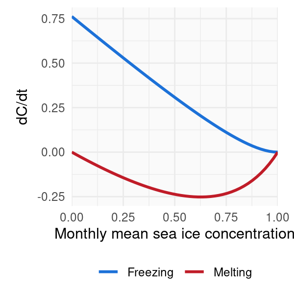{#fig-theory fig-align='center'}
:::
:::

To illustrate the basic properties of this simple model, @fig-theory shows the change in monthly sea ice concentration change as function of sea ice concentration for temperatures in the melting and freezing regimes. 
Parameters are all set arbitrarily to 1. 
For a given temperature below freezing (blue line), sea ice growth is maximum at low sea ice concentrations since that maximises both the heat loss and ice-free ocean that is available for freezing whereas at high sea ice concentrations heat fluxes are suppressed and there is little open water to freeze, leading to slow growth. 
For a  given temperature above freezing (red line), sea ice melt is slow both at low concentrations because there is little ice left to melt and at high concentrations because the ice insulates the ocean from the atmosphere. 
Maximum melt is at around 75% sea ice concentrations, when there is enough ice to melt and enough ice-free ocean for the ocean to exchange heat. 

## Observations

::: {.cell layout-align="center"}

:::

::: {.cell layout-align="center"}

:::

::: {.cell layout-align="center"}

:::

::: {.cell layout-align="center"}

:::

::: {.cell layout-align="center"}

:::

::: {.cell layout-align="center"}

:::

::: {.cell layout-align="center"}

:::

::: {.cell layout-align="center"}

:::

::: {.cell layout-align="center"}

:::

::: {.cell layout-align="center"}

:::

::: {.cell layout-align="center"}

:::

::: {.cell layout-align="center"}
::: {.cell-output-display}
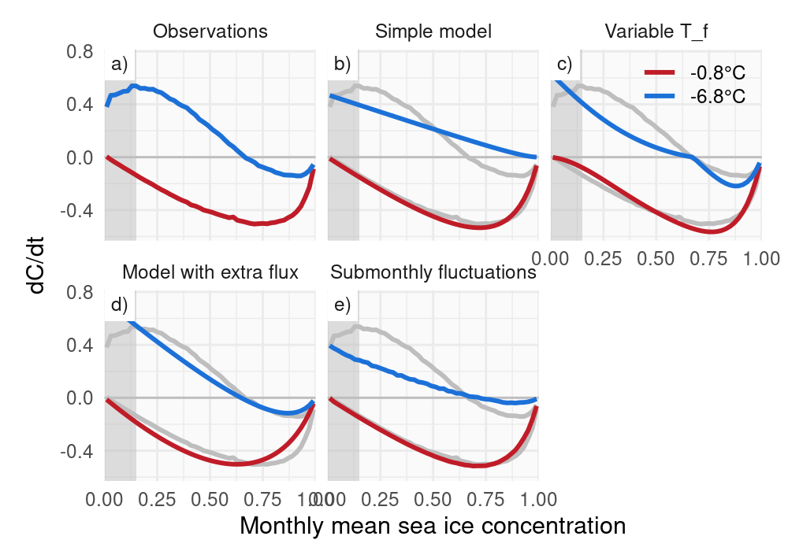{#fig-aice-lines fig-align='center'}
:::
:::

These basic properties of the the simple CTS are compared with observations in @fig-aice-lines. 
Observations are computed by averaging gridcells with temperatures of -7°C and -1°C $\pm$ 0.25°C and sea ice concentration values binned at boxes 2% wide. 
The overall observed curve fits notably well with the simple theory in the melt regime. 
Melt is zero at zero concentrations by mathematical necessity, but it is also low at high concentrations, showing the stabilisation effect of sea ice insulation. 
At 100% sea ice concentrations, melt values are not exactly zero. 
This in likely partly due to the binning -- which means that these values are actually the average of values between 95% and 100% -- but also likely a real effect that includes many processes that the model doesn't take into account, such as transp``ort, deformation, melting from below and heat exchange through the ice itself. 

In the growth regime, observations don't follow the simple model as well.
Although, they show low growth at high concentrations and high growth at low concentrations, they deviate from the simple model in two significant ways. 
First, at sea ice concentrations lower than 25%, growth starts to flatten out.
This could be due to missing processes, but it is also important to note that satellite observations are increasingly uncertain below ~15% and that there is no data between 0% and 10% concentrations. 
Second, at high concentrations sea ice actually melts even when exposed to low temperatures. 

::: {.cell layout-align="center"}
::: {.cell-output-display}
{#fig-daice-monthly fig-align='center'}
:::
:::

To understand this deficiency better, @fig-daice-monthly shows the complete CTS for observations and the simple model.
The black line marks the "zero line" that divides sea ice growth from melt, which is an estimate of the effective $T_f$ in @eq-flux. 
Contraty to the model's assumption, this zero line is not constant and instead depends heavily on sea ice concentration. 
At low concentration, air temperature just below -2°C is enough to cause sea ice growth on average, but as sea ice concentration increases, the air needs to be increasingly colder for ice not to melt. 
At about 50% sea ice concentration, air temperature need to be lower than -5°C for ice to grow. 
This property cannot be captured by the model in @eq-model, which assumes that sea ice will grow whenever air temperature is below the freezing point of ocean water, which is assumed constant. 

The freezing point of water depends on salinity and sea ice growth and melt directly affect surface salinity by brine rejection and releasing fresh water. 
However, no normal sea surface salinity value could explain a freezeing temperature of -5°C or below. 
Another possible issue is the assumption that ocean temperatures are constant. 
However, reproducing the same plot but using the difference between 2-metre air temperature and SST results in almost the same relationship (@fig-daice-monthly-sst).

The simple model could be altered to try to account for this discrepancy to gain insights into what is causing it. 
A direct refinement of the model is to postulate an ad-hoc dependency of $T_f$ on sea ice concentration. 
The black line in @fig-daice-monthly panel a is well modelled a fourth degree polinomial in @eq-tf-model fitted by linear regression. 

::: {.cell layout-align="center"}
$$
T_f = - 1.13 - 6.65C - 7.61C^2 + 24.36C^3 - 25.16C^4
$$ {#eq-tf-model}
:::

Replacing the constant $T_f$ in @eq-model with the expression in @eq-tf-model and fitting the parameters using observed data results in the CTS shown in @fig-daice-monthly panel c. 
This model reproduces the dependency of $T_f$ on sea ice concentration by definition. 
However, it slightly overestimates the melt ocurring at low temperatures at high sea ice concentrations and features a discontinuity in the derivative of $dI/dt$ with respect to sea ice concentration, creating a "kink" seen in @fig-aice-lines c. 
Moreover, as this is a wholly ad-hoc modification, it is not usefull to understand the physical processes that create this dependency. 
It would be preferrable to have a model in which the dependency of  $T_f$ with sea ice concentration arised as an emergent property from physically motivated rules. 

A physics-based refinement of the model is to pressupose a positive heat flux representing warming of the water from the bottom by mixing of relatively warmer subsurface water. 
Under this formulation, ice would grow only if the freezing at the surface from the atmosphere was larger than the melting from the ocean, which would require more extreme air temperature when ice insulation is higher at higher concentrations, thus creating an effective dependency on $T_f$ on sea ice concentration. 
Both wind forcing and waves can induce mixing, and both are dampened by the presence of sea ice, therefore this flux should also be proportional to the ice-free area.
In this full model the change in sea ice concentration is decomposed into change due to air fluxes and ocean fluxes. 

$$
\frac{dC}{dt} = \left.\frac{dC}{dt}\right|_a  + \left.\frac{dC}{dt}\right|_o 
$$

Where $\left.\frac{dC}{dt}\right|_a$ is the air temperature-induced changed computed as before and $\left.\frac{dC}{dt}\right|_o$ is the bottom ocean 

$$
\left.\frac{dC}{dt}\right|_o = \beta_m F_o C 
$$

Where $F_o = \gamma(1 - C)$. 
The new parameter $\gamma$ modulates the strength of the flux. 

The results for this model with parameters fitted to observations are shown in @fig-aice-lines d and @fig-daice-monthly d.
This model produces a $T_f$ dependency comparable with observations, although the exact shape is clearly not correct; it is too flat at low sea ice concentrations and too steep at high sea ice concentrations. 

Finally, the dependence of $T_f$ on sea ice concentations might be explained by sub-monthly temperature variations. 
For @fig-aice-lines e and @fig-daice-monthly e, I ran 5000 simulaitons of @eq-model in which I added a random normal perturbation to 2-meter temperature with mean zero and standard deviation taken from observations of monthly standard deviation of air temperature as a function of monthly mean temperature and monthly mean sea ice concentrations (@fig-t2m_sd).
Random submonthly temperature fluctuations approximate $T_f$ well but it subestimates sea ice growth at low sea ice concentrations. 
Note that the standard deviation includes daily fluctuations as well as the daily trend in temperature from the seasonal cycle. 
It is not clear why intramonthly 2-m temperature variability increases so much at low temperatures. 
Note that there is little dependence of variabilty on sea ice concentration, suggesting that bufering from the ocean and insulation by sea ice can only play a minor role. 

An alternative model imposing a damping forcing that relaxes sea ice concentrations towards a temperature-dependent value was tried. 
This formulation would attempt to take into account that gridpoints with either particularly high or low sea ice concentration values compared with their surroundings will tend to either export ice away or gain ice from their neighbours. 
However, the estimated damping strength from observations was minimal and could not explain the observed shaped of the ice-temperature surface and was not consistent with the observed minimal melt at 100% sea ice concentraions. 

::: {.cell layout-align="center"}

:::

::: {.cell layout-align="center"}
::: {.cell-output-display}
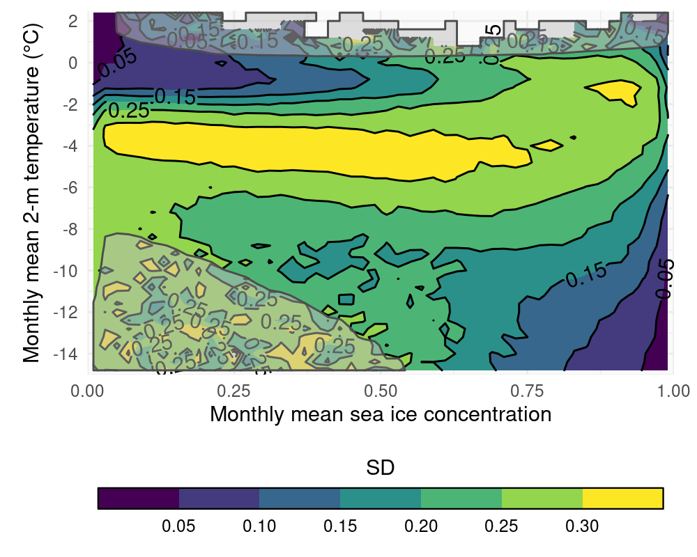{#fig-grid-sd fig-align='center'}
:::
:::

The average error of the predicting $dC/dt$ from air temperature and sea ice concentration, estimated as the standard deviation of observations conditioned by the observed Concentration Tendency Surface (@fig-daice-monthly panel a) excluding air temperature greater than 0°C and no ice is present, is 0.160. 
For comparison, the standard deviation of sea ice change is 0.232.
The Concentration Tendency Surface therefore explains 52% of the variance in sea ice concentration change. 
@fig-grid-sd shows the standard deviation of $dC/dt$ as a function of temperature and sea ice concentration and illustrates that this mean error is in no way homogeneous. 
Both for low sea ice concentrations at higher temperatures, and for high sea ice concentration at low temperature the error is lower than 0.15.
The error increases to between 0.2 and 0.35 at temperatures between -5°C and -3°C and sea ice concentration below 0.75. 
This suggests that ice dynamics and ocean processes are particularly important at these intermediate tempeartures. 
\todo[]{I feel this part needs to be moved before, like a justification to show that the Concentration Tendency Surface actually exists}

## Using the Concentration Tendency Surface to predict sea ice

::: {.cell layout-align="center"}

:::

::: {.cell layout-align="center"}

:::

Since the Concentration Tendency Surface defines a prognostic equation of sea ice concentration, we can integrate it in time using temperature fields as forcing. 
This can help in understanding what aspects of sea ice variabilty can be explained by the Concentration Tendency Surface. 
By integrating both the Concentration Tendency Surface from @eq-model and the observed one (@fig-daice-monthly panels b and a respectively) I can further analyise the impact of modelling the dependency of $T_f$ on sea ice concentration. 
The observed Concentration Tendency Surface is not defined for unobserved values of sea ice concentation and temperatures and it is highly uncertain in region of that space with sparce observations.
To address both issues, I smooth the surface with 2D loess smooth utilising only parts of the grid with more than 100 observations and extrapolate the extreme values in regions with no data. 
I use ERA5 2-m temperature as forcing and integrate the models using January 1983 observations as initial conditions and run it until December 2023. 
For comparison, I use sea ice concentration forecasts with a 1 month lead time by ACCESS-S2 [REF], the Bureau of Meteorology Subseasonal to Seasonal prediction model. 

::: {.cell layout-align="center"}

:::

::: {.cell layout-align="center"}

:::

::: {.cell layout-align="center"}

:::

::: {.cell layout-align="center"}

:::

::: {.cell layout-align="center"}

:::

::: {.cell layout-align="center"}
::: {.cell-output-display}
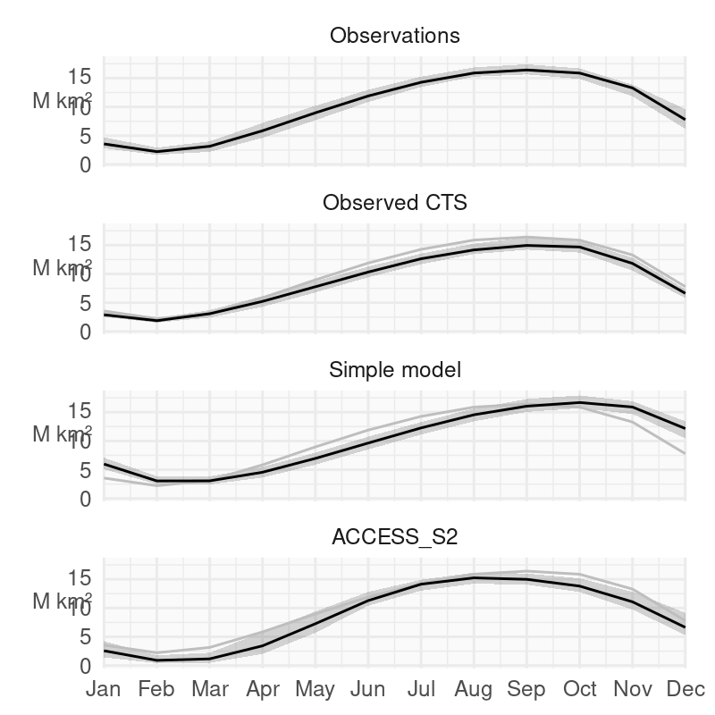{#fig-seasonal-cycle fig-align='center'}
:::
:::

The Concentration Tendency Surfaces seem to simulate sea ice quite well compared with a coupled model.
@fig-seasonal-cycle shows the seasonal cycle of sea ice area for of simulations based on the simple model, the model based on observations and 1-month forecast of ACCESS-S2. 
Both CTS-based models experience a seasonal cycle of similar amplitude to observations, although the in the simple model, its phase is shited by about one month. 

::: {.cell layout-align="center"}

:::

::: {.cell layout-align="center"}
::: {.cell-output-display}
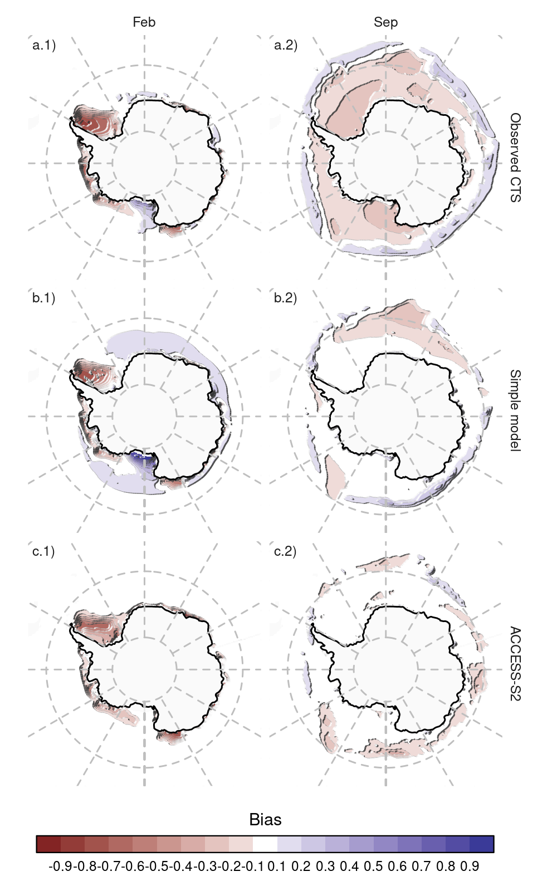{#fig-bias fig-align='center'}
:::
:::

However, this aggregated quantity hides spatial variation. 
@fig-bias shows that sea ice concentration bias localy high in the models.
ALl three models show a strong low concentration bias in the Weddell Sea in February, while the models based in Concentration Tendency Surfaces models also exhibit high concentraiton bias in the Ross Sea. 
It is likely that the lack of dynamical processes in these models is what is causing this bias. 
If that is the case, then the fact that the coupled model share the same feature suggest a problem in the dynamics of the model. 

::: {.cell layout-align="center"}
::: {.cell-output-display}
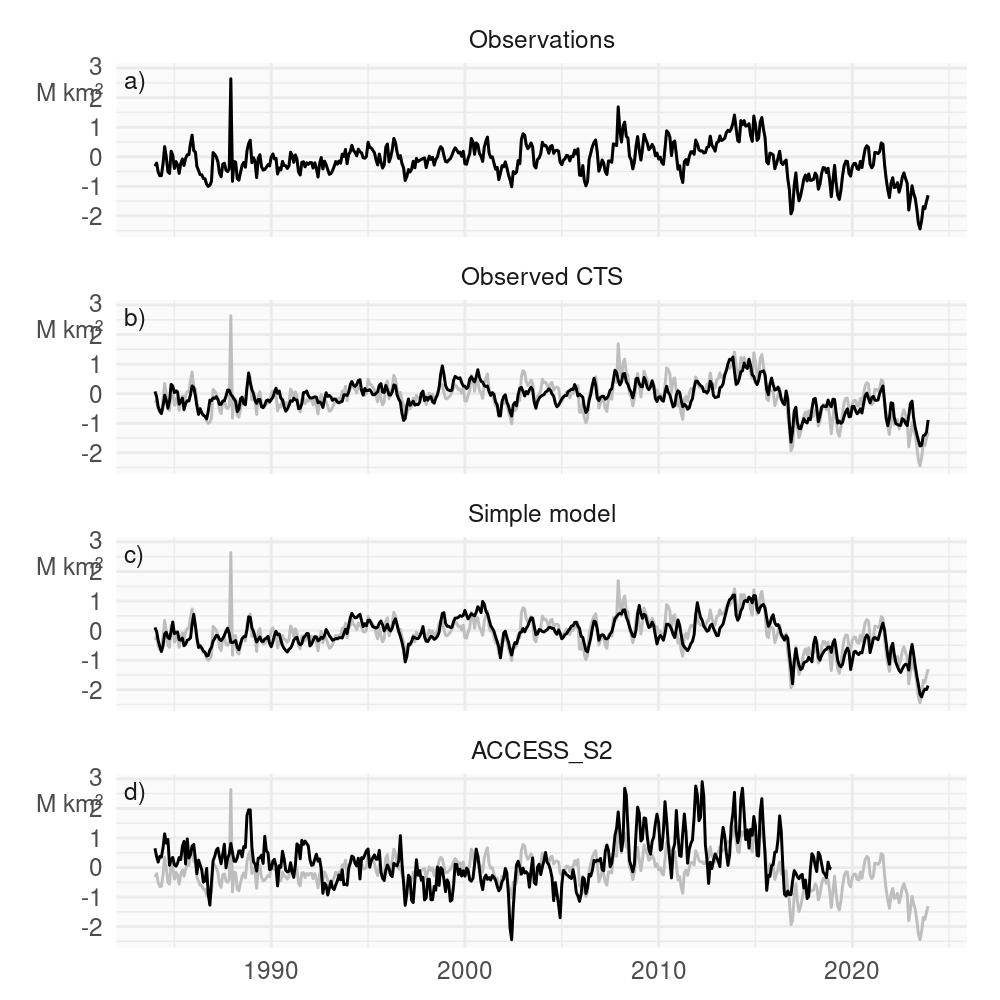{#fig-area-anomalies fig-align='center'}
:::
:::

Despite large local biases, the statistical models simulate sea ice area anomalies remarcable well (@fig-area-anomalies). \todo{more information here}

::: {.cell layout-align="center"}

:::

::: {.cell layout-align="center"}
::: {.cell-output-display}
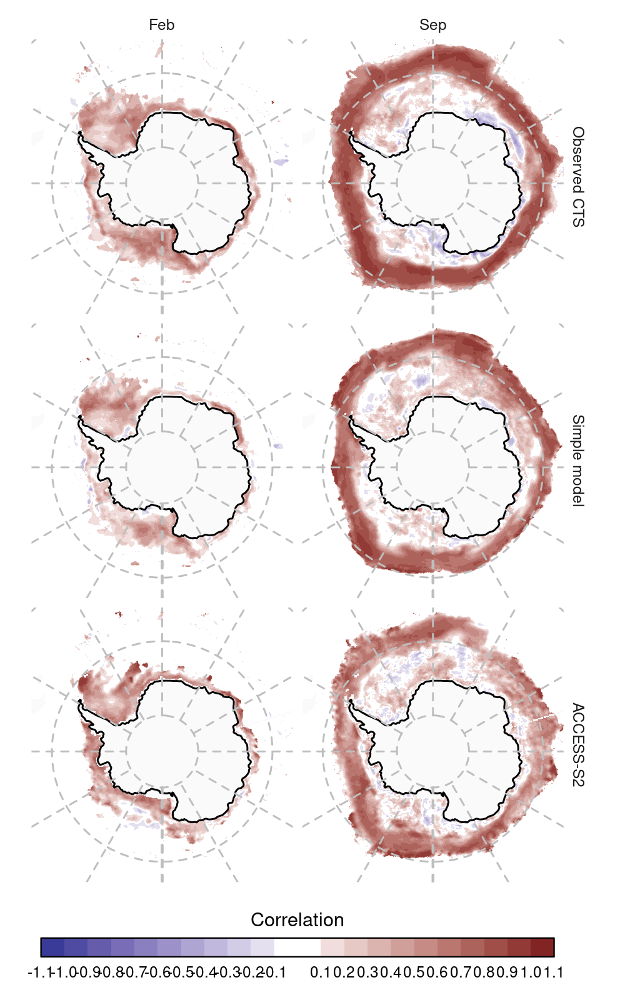{#fig-spatial-cor fig-align='center'}
:::
:::

@fig-spatial-cor shows the correlation of sea ice anomalies for Febuary and Septemeber. 
In Summer, models have comparable low correlation values, however in Spring, the statistical models show higher correlation that the coupled model in the ice edge, although correlations are near zero in the core of the ice pack. 
This likely is related to the low variance of sea ice concentrations in that region, where it's almost 100% every September. 
This can be seen in @fig-sd, that compares interannual standard deviation. 

::: {.cell layout-align="center"}
::: {.cell-output-display}
{#fig-sd fig-align='center'}
:::
:::

While the statistical model does well in terms of correlation and Pan-Antarctic sea ice area, one important limitation is that the variability of the simulated sea ice concentrations is much lower than either observations or the coupled model simulation (@fig-sd). 
Lower variabilty is not unexpected since the Concentration Tendency Surface doesn't include many sources of variability such as advection, divergence, thickness redistribution and ocean processes. 

## CMIP6

The Concentation Tendency Surface shown in @fig-daice-monthly a is assumed to be an emergent property of thermodynamic processes and interactions between sea ice and the atmosphere. 
To understand to what extent this relationship is stable and predictive of sea ice behaviour, we analyse it using historical simulations and SSP585 projections of CMIP6 models. 

 

::: {.cell layout-align="center"}

:::

::: {.cell layout-align="center"}

:::

::: {.cell layout-align="center"}
::: {.cell-output-display}
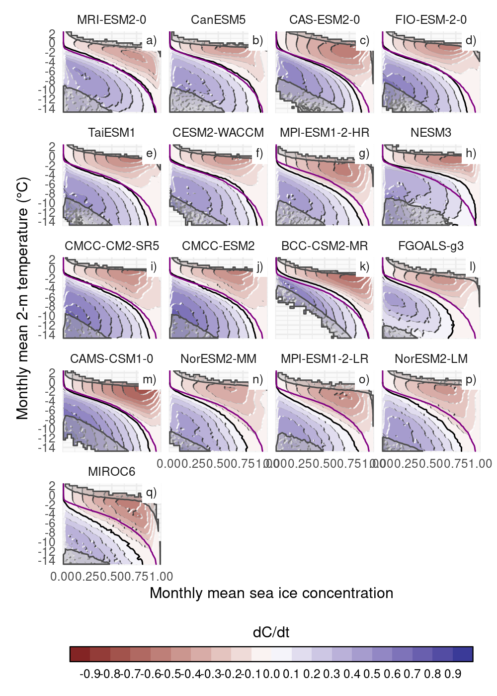{#fig-cmip-historical fig-align='center'}
:::
:::

@fig-cmip-historical shows the relationship between sea ice concentration change, air temparature and sea ice concentration. 
All models the relationship follows the overall shape found in observations, indicating that this is a stable and physically meaninful relationship. 
However, there are indeed variation between models. 
Focusing only on the zero line, we observe that most models have a melt bias, in the sense that they lose sea ice at lower temperaturess than in observations. 
MIROC6 ([Fig. @fig-cmip-historical]s) is a particularly loses ice at temperatures as cold as -6°C at 50% sea ice concentration. 
The only models with a freeze bias (ice growing at higher temperatures than in observations) are ACCESS-CM2 and NESM3 ([Fig. @fig-cmip-historical]g and i). 

::: {.cell layout-align="center"}
::: {.cell-output-display}
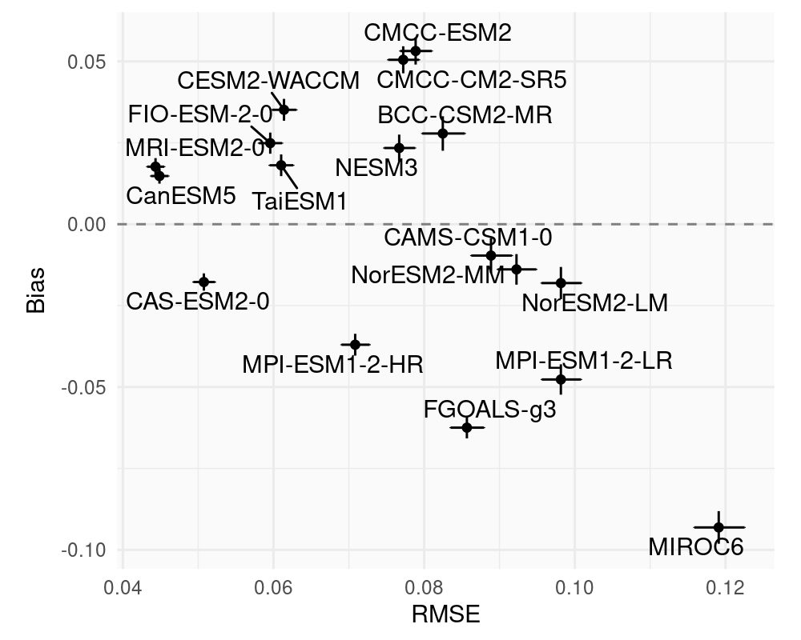{#fig-rmse-bias fig-align='center'}
:::
:::

This evaluation of bias is incomplete since it is only based on the zero line and ignores the magntiude of melt of freeze at different temperatures and sea ice concentrations. 
@fig-rmse-bias shows the bias and RMSE in change in sea ice concentration of each model compared with observations. 
Of the 17 evaluated models, 8 have an overall negative bias and 9 have positive bias an compared with observations. 
ACCESS-ESM1.5 is the only model that has statistically no bias in the historical simulation. 
With the exception of MIROC6, the magnitude of positive biases is similar to the magitude of negative biases, and the average bias accross models is -0 (CI: -0.02 -- 0.02), indicating that neither warm nor cold models dominate. 
However, models with negative bias tend to have larger RMSE, indicating large errors that compensate. 

::: {.cell layout-align="center"}

:::

::: {.cell layout-align="center"}
::: {.cell-output-display}
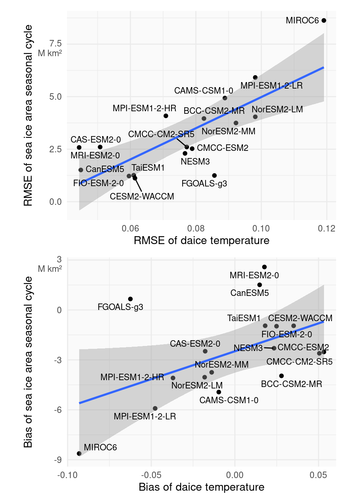{#fig-cmip-errors fig-align='center'}
:::
:::

To test if errors in the temperature-ice relationship translate to errors in model representation of sea ice, @fig-cmip-errors compares these errors with errors in the representation of the seasonal cycle. 
RMSE of the temperature-ice relationship is highly predictive of RMSE in the seasonal cycle. 
Models where this relation is similar to observations simulate a seasonal cycle closer to the observed. 
Bias is less predictive than RMSE. 
Even models with a freeze bias, like CESM2_WACCM or ACCESS-CM2, exhibit a negative sea ice area bias. 
There is a trend for lower negative sea ice area bias in those models with freeze bias, but that relationship is weaker than the RMSE one. 

## Conclusions

## Acknowledgments

We acknowledge the World Climate Research Programme, which, through its Working Group on Coupled Modelling, coordinated and promoted CMIP6. We thank the climate modeling groups for producing and making available their model output, the Earth System Grid Federation (ESGF) for archiving the data and providing access, and the multiple funding agencies who support CMIP6 and ESGF.

Caroline Holmes for idea of stochastic addition.

## Open research

Phasellus interdum tincidunt ex, a euismod massa pulvinar at. Ut fringilla ut nisi nec volutpat. Morbi imperdiet congue tincidunt. Vivamus eget rutrum purus. Etiam et pretium justo. Donec et egestas sem. Donec molestie ex sit amet viverra egestas. Nullam justo nulla, fringilla at iaculis in, posuere non mauris. Ut eget imperdiet elit.

## References {.unnumbered}

\clearpage

## Supplementary figures {.appendix}

\appendix

::: {.cell layout-align="center"}
::: {.cell-output-display}
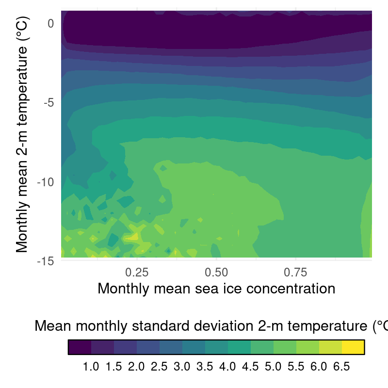{#fig-t2m_sd fig-align='center'}
:::
:::

::: {.cell layout-align="center"}
::: {.cell-output-display}
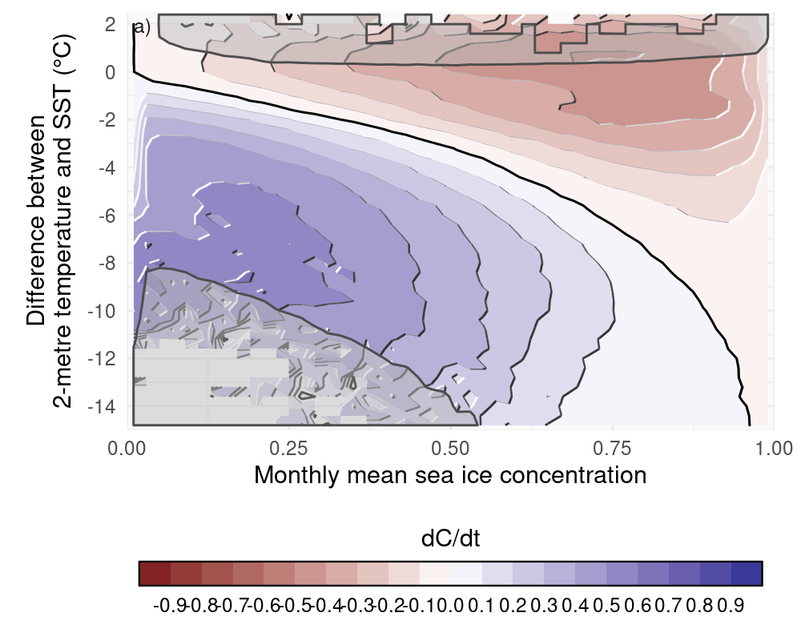{#fig-daice-monthly-sst fig-align='center'}
:::
:::

::: {.cell layout-align="center"}
::: {.cell-output-display}
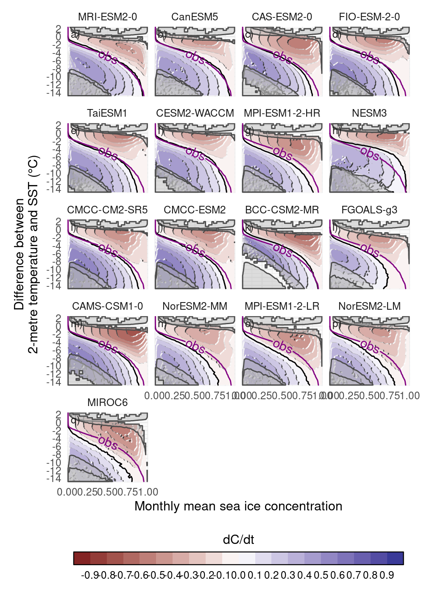{#fig-cmip-historical_old fig-align='center'}
:::
:::

::: {.cell layout-align="center"}
::: {.cell-output-display}
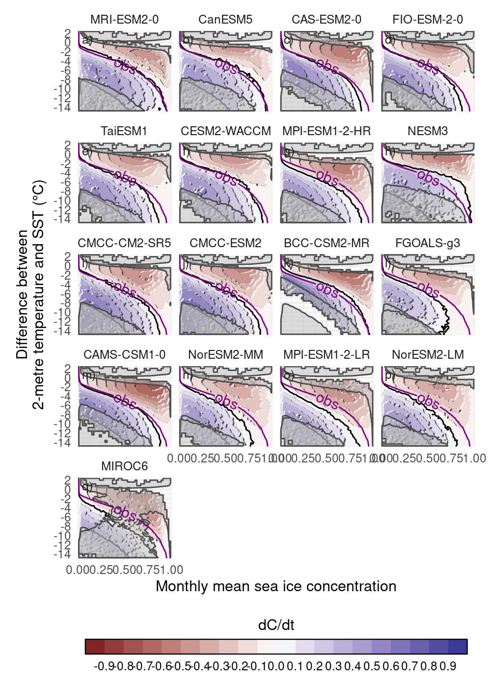{#fig-cmip-historical_new fig-align='center'}
:::
:::

::: {.cell layout-align="center"}
::: {.cell-output-display}
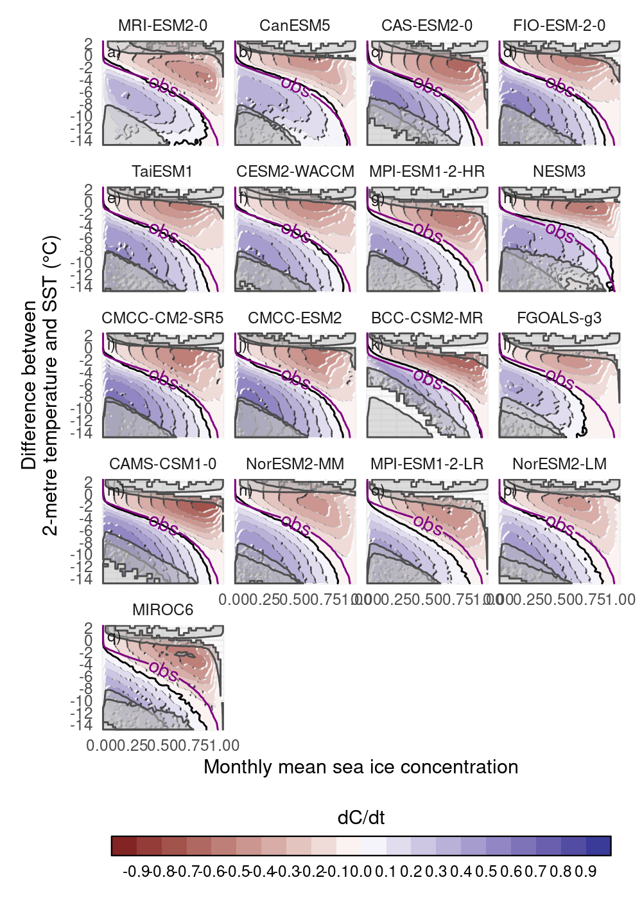{#fig-cmip-ssp585 fig-align='center'}
:::
:::

